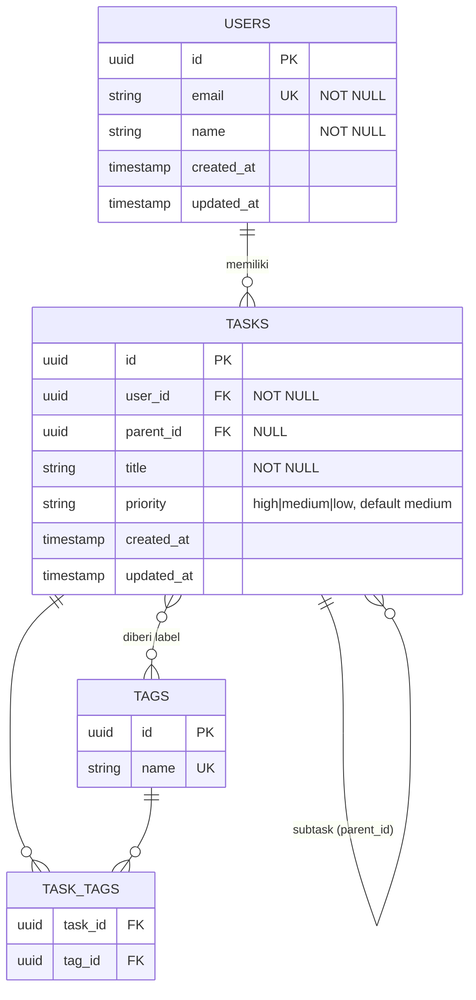

# AGENT_RULES.md — Aturan Wajib untuk AI Coding Agent

> File ini adalah **hukum tertinggi** selama agent bekerja di repository ini.
> Baca seluruh file ini **sebelum menulis satu baris kode pun**, dan baca ulang setiap memulai sesi baru.
> Jika ada konflik antara instruksi lisan dan file ini, **berhenti dan tanyakan** ke pemilik proyek.

---

## 0. Prinsip Utama

1. **PRD adalah sumber kebenaran.** Tidak ada fitur, halaman, endpoint, tabel, atau dependensi di luar PRD.
2. **Urutan kerja tidak boleh dilompati:** `Frontend → Skema Database → Backend → Deploy Ready`.
3. **Semua yang dikerjakan harus tercatat** (dokumentasi + commit).
4. **Satu perubahan kecil = satu commit.** Jangan menumpuk pekerjaan besar dalam satu commit.
5. **Jangan berasumsi.** Jika PRD ambigu atau kurang, tulis di `docs/QUESTIONS.md` dan tanyakan. Jangan menebak.
6. **Jangan merusak yang sudah jalan.** Setiap perubahan harus lolos lint, typecheck, dan test sebelum commit.

---

## 1. Struktur Folder Wajib

Agent harus membuat dan memelihara struktur berikut (sesuaikan nama stack, tapi pertahankan folder dokumentasi):

```
/
├── AGENT_RULES.md              # file ini (jangan diubah oleh agent)
├── README.md                   # cara install, run, build, deploy
├── CHANGELOG.md                # riwayat rilis (Keep a Changelog)
├── .env.example                # daftar env var TANPA nilai rahasia
├── tasks/
│   └── prd-[nama-fitur].md     # PRD (read-only bagi agent)
├── docs/
│   ├── PROGRESS.md             # status tiap user story (US-xxx)
│   ├── WORKLOG.md              # log kerja kronologis (append-only)
│   ├── DECISIONS.md            # keputusan teknis + alasannya (ADR ringkas)
│   ├── QUESTIONS.md            # pertanyaan / ambiguitas PRD yang belum dijawab
│   ├── DATABASE.md             # skema DB: ERD, kamus data, relasi, index (fase skema database)
│   ├── API.md                  # dokumentasi endpoint (draft di frontend, final di backend)
│   ├── DEPLOYMENT.md           # panduan deploy (diisi di fase deploy)
│   └── CHANGE_REQUESTS.md      # permintaan perubahan PRD (lihat Bagian 7)
├── database/
│   └── schema.sql              # draf DDL referensi (bukan migration resmi)
├── frontend/
├── backend/
└── ...
```

**Aturan:**
- `tasks/prd-*.md` **TIDAK BOLEH diedit** oleh agent. Hanya manusia yang boleh mengubah PRD.
- `docs/WORKLOG.md` bersifat **append-only** — jangan menghapus atau menulis ulang entri lama.

---

## 2. Aturan Kepatuhan terhadap PRD

### 2.1 Sebelum mulai (wajib)
1. Baca seluruh `tasks/prd-*.md`.
2. Buat/perbarui `docs/PROGRESS.md` berisi **semua User Story (US-xxx)** dan **Functional Requirement (FR-x)** dari PRD dengan status awal `TODO`.
3. Catat bagian **Non-Goals** dari PRD — ini adalah daftar larangan.

### 2.2 Selama bekerja
- Setiap tugas **harus dipetakan** ke minimal satu `US-xxx` atau `FR-x`. Jika tidak bisa dipetakan → **jangan dikerjakan**.
- Kerjakan **satu User Story dalam satu waktu**, sesuai urutan di PRD kecuali PRD menyatakan lain.
- Sebuah User Story baru dianggap `DONE` jika **semua Acceptance Criteria** terpenuhi dan terverifikasi (bukan sekadar "terlihat jalan").

### 2.3 Larangan (Scope Guard)
Agent **DILARANG**:
- Menambah fitur, halaman, field, tabel, atau endpoint yang tidak ada di PRD ("sekalian biar bagus").
- Mengerjakan apa pun yang tercantum di **Non-Goals**.
- Mengganti stack, framework, atau library utama tanpa persetujuan (lihat Bagian 7).
- Mengubah desain/UX yang sudah ditentukan di PRD.
- Membuat tabel, kolom, relasi, atau index yang tidak ada di `docs/DATABASE.md` yang disetujui (dan tidak berdasar PRD).
- Menulis migration atau kode backend sebelum skema database berstatus `APPROVED`.
- Melakukan refactor besar yang tidak diminta oleh PRD.
- Menambah dependensi baru tanpa mencatatnya di `docs/DECISIONS.md` beserta alasannya.

### 2.4 Jika menemukan masalah di PRD
Contoh: requirement bertentangan, kurang detail, atau tidak mungkin diimplementasi.
1. **Hentikan** pekerjaan pada bagian tersebut.
2. Tulis di `docs/QUESTIONS.md` (format di Bagian 8.5).
3. Lanjutkan ke User Story lain yang tidak terblokir, atau berhenti dan minta jawaban.
4. **Jangan memilih sendiri** interpretasi yang "paling masuk akal" tanpa konfirmasi.

---

## 3. Alur Kerja Wajib: Frontend → Backend → Deploy Ready

Fase **tidak boleh dilompati**. Pindah ke fase berikutnya hanya jika **Gate** fase sebelumnya terpenuhi dan dicatat di `docs/PROGRESS.md`.

```
[Fase 0: Setup] → [Fase 1: Frontend] → [Fase 2: Skema Database] → [Fase 3: Backend] → [Fase 4: Deploy Ready]
```

### Fase 0 — Setup & Perencanaan
**Tugas:**
- [ ] Baca PRD, buat `docs/PROGRESS.md` (semua US & FR berstatus `TODO`).
- [ ] Inisialisasi git, `.gitignore`, branch `main` dan `develop`.
- [ ] Buat struktur folder (Bagian 1) dan `README.md` awal.
- [ ] Catat pilihan stack di `docs/DECISIONS.md` (hanya jika PRD tidak menentukannya; jika PRD menentukan, ikuti PRD).
- [ ] Setup lint, formatter, typecheck, dan test runner.
- [ ] Buat `.env.example`.

**Gate 0:** Proyek bisa dijalankan kosong (`dev` start tanpa error), lint & typecheck lolos, commit awal sudah dibuat.

---

### Fase 1 — Frontend
**Tujuan:** Seluruh UI dan alur pengguna dari PRD berfungsi, menggunakan **data mock/statis** yang strukturnya meniru kontrak API.

**Aturan:**
- Kerjakan sesuai User Story bertanda UI di PRD.
- Data sementara disimpan di `frontend/src/mocks/` (atau setara) dan **dipisahkan** dari komponen agar mudah diganti API asli.
- **Definisikan kontrak data** (tipe/skema request & response) di satu tempat, misalnya `frontend/src/types/` atau `shared/`. Kontrak ini akan menjadi acuan backend.
- Semua pemanggilan data lewat satu lapisan (`services/` atau `api/`) — komponen **tidak boleh** memanggil fetch/mock langsung.
- Tangani state: loading, empty, error, dan sukses.
- Responsif dan aksesibel sesuai yang ditentukan PRD (Design Considerations).
- Tidak ada `console.log` sisa, kode mati, atau `TODO` tanpa referensi ke US/FR.

**Verifikasi (wajib per User Story UI):**
- Jalankan aplikasi dan **uji manual di browser** sesuai Acceptance Criteria.
- Lint, typecheck, dan test komponen lolos.
- Catat hasil verifikasi di `docs/WORKLOG.md`.

**Gate 1 (Frontend Selesai):**
- [ ] Semua US bertipe UI berstatus `DONE` di `docs/PROGRESS.md`.
- [ ] Semua halaman & alur di PRD bisa dijalankan dengan data mock.
- [ ] Kontrak data/API terdokumentasi di `docs/API.md` (draft).
- [ ] Semua entitas & field data yang muncul di UI/mock sudah terdaftar di kontrak data (bahan untuk perancangan skema).
- [ ] Build produksi frontend berhasil (`build` tanpa error/warning kritis).
- [ ] Merge ke `develop` + tag `v0.1.0-frontend`.

> 🚫 **Dilarang mulai perancangan skema database dan backend sebelum Gate 1 terpenuhi.**

---

### Fase 2 — Perancangan Skema Database
**Tujuan:** Merancang skema database yang **lengkap, ternormalisasi, dan memuat seluruh relasi antar tabel** berdasarkan PRD dan kontrak data dari Fase 1, **sebelum** satu pun kode backend atau migration ditulis. Fase ini menghasilkan **dokumen desain**, bukan implementasi.

**Sumber rancangan (urutan prioritas):**
1. PRD (User Stories, Functional Requirements, Technical Considerations).
2. Kontrak data & tipe di frontend (`frontend/src/types/`) serta data mock di `frontend/src/mocks/`.
3. Draf `docs/API.md` dari Fase 1.

**Langkah-langkah wajib (kerjakan berurutan):**

1. **Identifikasi entitas.** Daftarkan semua entitas/tabel yang dibutuhkan PRD. Setiap entitas **harus** bisa ditelusuri ke minimal satu `US-xxx` atau `FR-x`. Entitas tanpa dasar di PRD **dilarang**.
2. **Definisikan atribut (kolom).** Untuk setiap kolom tentukan: nama, tipe data, `NULL`/`NOT NULL`, nilai default, `UNIQUE`, dan batasan (`CHECK`, enum). Setiap field yang tampil di UI atau data mock **harus** punya kolom, atau diberi alasan mengapa dihitung (computed).
3. **Tentukan Primary Key.** Satu strategi PK konsisten di seluruh skema (misalnya `id` UUID atau BIGINT auto-increment). Catat pilihannya di `docs/DECISIONS.md`.
4. **Tentukan relasi antar tabel (wajib lengkap).** Untuk **setiap pasang tabel yang berhubungan**, catat:
   - Jenis relasi: **1:1**, **1:N**, atau **N:M**.
   - Kolom Foreign Key beserta tabel & kolom yang dirujuk.
   - Kardinalitas dan opsionalitas (wajib/opsional di tiap sisi).
   - Aturan `ON DELETE` dan `ON UPDATE` (`CASCADE` / `RESTRICT` / `SET NULL` / `NO ACTION`) **beserta alasannya**.
   - Relasi **N:M wajib** memakai **tabel penghubung (junction table)** dengan PK komposit atau unique constraint pada pasangan FK.
   - Relasi **self-referencing** (misalnya parent–child, subtask) ditulis eksplisit bila ada.
5. **Normalisasi.** Skema minimal mencapai **3NF**. Denormalisasi hanya boleh dengan alasan performa/PRD dan **harus dicatat** di `docs/DECISIONS.md`.
6. **Rancang index.** Wajib: PK, semua FK, kolom `UNIQUE`, serta kolom yang dipakai untuk filter/sort/pencarian di PRD (contoh: filter prioritas → index pada `priority`). Jangan menambah index tanpa dasar kebutuhan PRD.
7. **Kolom standar & kebijakan data.** Tentukan `created_at` dan `updated_at` pada semua tabel utama. Gunakan `deleted_at` (soft delete) **hanya jika** PRD membutuhkan riwayat/pemulihan data. Catat kebijakan timezone (disarankan UTC).
8. **Konvensi penamaan.** Satu gaya konsisten, misalnya: tabel `snake_case` jamak (`tasks`), kolom `snake_case`, FK `<tabel_tunggal>_id` (`user_id`), junction `a_b` (`task_tags`). Catat di dokumen skema.
9. **Rancang data awal (seed).** Tentukan data referensi/master yang wajib ada (role, status, kategori) bila dibutuhkan PRD. Data dummy untuk development dipisahkan dari seed produksi.
10. **Buat ERD** (Entity Relationship Diagram) memakai **Mermaid** di `docs/DATABASE.md` agar bisa dirender langsung di repository.
11. **Validasi skema (wajib sebelum minta persetujuan).** Lakukan *walkthrough* tertulis: untuk **setiap User Story**, tunjukkan tabel & query/operasi apa yang dipakai. Pastikan:
    - Semua FR dan US yang menyimpan/membaca data terpenuhi oleh skema.
    - Tidak ada tabel yatim (tanpa relasi atau tanpa kegunaan di PRD).
    - Tidak ada relasi yang menggantung (FK tanpa tabel tujuan).
    - Tidak ada redundansi data yang tidak disengaja.
    - Tidak ada kolom/tabel di luar PRD (cek juga terhadap **Non-Goals**).
12. **Minta persetujuan eksplisit.** Setelah dokumen selesai, **berhenti** dan minta pemilik proyek me-review `docs/DATABASE.md`. Tanpa persetujuan tertulis (dicatat di dokumen), **dilarang** lanjut ke Fase 3.

**Output wajib di `docs/DATABASE.md`:**
- Ringkasan & konvensi (DBMS, penamaan, strategi PK, timezone).
- **ERD Mermaid** yang memuat semua tabel, kolom kunci, dan relasi.
- **Kamus data (data dictionary)** untuk setiap tabel.
- **Matriks relasi** semua FK beserta aturan `ON DELETE/UPDATE`.
- **Daftar index** beserta alasan kebutuhannya.
- **Tabel keterlacakan** (entitas → US/FR).
- **Hasil walkthrough** per User Story.
- Rencana seed data.
- Status persetujuan (`DRAFT` / `APPROVED` + tanggal + penyetuju).

**Template minimal `docs/DATABASE.md`:**

````markdown
# Skema Database
**Status:** DRAFT | APPROVED (oleh: ___, tanggal: ___)
**DBMS:** PostgreSQL | **PK:** UUID | **Timezone:** UTC | **Penamaan:** snake_case, tabel jamak

## 1. ERD


## 2. Kamus Data — `tasks`
| Kolom | Tipe | Null | Default | Constraint | Keterangan | Ref PRD |
|-------|------|------|---------|------------|------------|---------|
| id | uuid | NO | gen | PK | Identitas task | FR-1 |
| user_id | uuid | NO | - | FK → users.id | Pemilik task | US-001 |
| priority | varchar(6) | NO | 'medium' | CHECK IN (high,medium,low) | Prioritas | FR-1 |

## 3. Matriks Relasi
| Dari (FK) | Ke (PK) | Jenis | Wajib? | ON DELETE | ON UPDATE | Alasan |
|-----------|---------|-------|--------|-----------|-----------|--------|
| tasks.user_id | users.id | N:1 | Ya | CASCADE | CASCADE | Task ikut terhapus bila user dihapus |
| task_tags.task_id | tasks.id | N:1 | Ya | CASCADE | CASCADE | Junction N:M tasks–tags |

## 4. Index
| Tabel | Kolom | Tipe | Alasan | Ref PRD |
|-------|-------|------|--------|---------|
| tasks | user_id | BTREE | FK + listing per user | US-001 |
| tasks | priority | BTREE | Filter prioritas | US-004 |

## 5. Keterlacakan
| Tabel | US/FR terkait |
|-------|---------------|
| tasks | US-001, US-002, FR-1 |

## 6. Walkthrough per User Story
- **US-004 (filter prioritas):** `SELECT ... FROM tasks WHERE user_id = ? AND priority = ?` → memakai index `tasks(priority)`.

## 7. Seed Data
- (daftar data referensi wajib)
````

**Aturan khusus Fase 2:**
- **Dilarang** membuat file migration, model ORM, atau kode backend pada fase ini.
- Boleh membuat draf DDL referensi di `database/schema.sql` hanya sebagai pelengkap dokumen, bukan sebagai migration resmi.
- Skema harus mencakup **seluruh** data yang dibutuhkan PRD, tidak kurang dan tidak lebih.
- Jika kebutuhan data tidak jelas, catat di `docs/QUESTIONS.md` dan tanyakan sebelum merancang bagian itu.

**Gate 2 (Skema Database Selesai & Disetujui):**
- [ ] `docs/DATABASE.md` memuat semua output wajib (ERD, kamus data, matriks relasi, index, keterlacakan, walkthrough).
- [ ] Setiap tabel & kolom terlacak ke `US-xxx`/`FR-x`; tidak ada yang di luar PRD.
- [ ] Semua relasi (1:1, 1:N, N:M, self-reference) terdefinisi lengkap dengan FK dan aturan `ON DELETE/UPDATE`.
- [ ] Skema mencapai minimal 3NF (pengecualian tercatat di `docs/DECISIONS.md`).
- [ ] Walkthrough membuktikan setiap User Story yang menyentuh data dapat dipenuhi.
- [ ] **Persetujuan eksplisit pemilik proyek** tercatat (`Status: APPROVED`).
- [ ] Merge ke `develop` + tag `v0.2.0-database`.

> 🚫 **Dilarang mulai backend/migration sebelum Gate 2 terpenuhi.**

---

### Fase 3 — Backend
**Tujuan:** Mengimplementasikan database (dari skema yang sudah disetujui), API, dan logika bisnis sesuai kontrak dari Fase 1, lalu menghubungkan frontend ke backend nyata.

**Aturan:**
- **Langkah pertama backend:** terjemahkan `docs/DATABASE.md` (status `APPROVED`) menjadi **migration** dan model/entitas. Hasil implementasi harus **identik** dengan skema yang disetujui: tabel, kolom, tipe, constraint, FK, `ON DELETE/UPDATE`, dan index.
- **Dilarang menyimpang dari skema yang disetujui.** Jika implementasi menuntut perubahan skema:
  1. Hentikan dan catat di `docs/CHANGE_REQUESTS.md` (dan `docs/DECISIONS.md`).
  2. Perbarui `docs/DATABASE.md` (ERD, kamus data, matriks relasi) **dalam commit yang sama** dengan migration baru.
  3. Tunggu persetujuan pemilik proyek sebelum melanjutkan.
- Semua perubahan skema database **wajib lewat migration** (tidak ada perubahan manual) dan harus bisa di-rollback.
- Implementasikan **hanya** endpoint yang dibutuhkan oleh PRD dan kontrak di `docs/API.md`.
- Validasi semua input di sisi server. Jangan percaya data dari frontend.
- Autentikasi/otorisasi diterapkan sesuai PRD. Jangan membuat endpoint tanpa proteksi jika PRD mensyaratkannya.
- Error response konsisten (format seragam, kode HTTP tepat, tanpa membocorkan detail internal).
- **Dilarang** meng-hardcode secret, kredensial, atau API key. Gunakan environment variable dan update `.env.example`.
- Tulis test (unit/integrasi) untuk logika bisnis dan endpoint utama, termasuk test integritas relasi (FK, unique, cascade) yang penting bagi PRD.
- Setelah endpoint siap, **ganti mock di frontend dengan API nyata** lewat lapisan `services/` (tanpa mengubah komponen UI).
- Perbarui `docs/API.md` agar sesuai implementasi final (method, path, request, response, error, contoh).

**Verifikasi (wajib per User Story):**
- Test backend lolos.
- Uji alur end-to-end dari UI ke database sesuai Acceptance Criteria.
- Catat hasilnya di `docs/WORKLOG.md`.

**Gate 3 (Backend Selesai):**
- [ ] Semua US & FR di PRD berstatus `DONE`.
- [ ] Migration dari database kosong berjalan tanpa error dan hasilnya **sesuai** `docs/DATABASE.md` (tidak ada selisih tabel/kolom/relasi/index).
- [ ] Tidak ada lagi data mock yang dipakai di jalur produksi.
- [ ] Seluruh test, lint, dan typecheck lolos.
- [ ] `docs/API.md` dan `docs/DATABASE.md` sesuai implementasi.
- [ ] Merge ke `develop` + tag `v0.3.0-backend`.

> 🚫 **Dilarang mulai fase deploy sebelum Gate 3 terpenuhi.**

---

### Fase 4 — Deploy Ready
**Tujuan:** Aplikasi siap dirilis oleh manusia. Agent **menyiapkan** deploy, bukan men-deploy ke production tanpa izin.

**Tugas:**
- [ ] Konfigurasi build produksi untuk frontend & backend.
- [ ] Buat `Dockerfile` / `docker-compose.yml` / konfigurasi platform (sesuai stack & PRD).
- [ ] Pastikan semua konfigurasi lewat environment variable; `.env.example` lengkap dan terdokumentasi.
- [ ] Siapkan prosedur migration & seed untuk production, termasuk **backup dan rollback database**.
- [ ] Siapkan CI (lint → typecheck → test → build) bila PRD/proyek mensyaratkan.
- [ ] Siapkan health check endpoint (termasuk cek koneksi database) dan penanganan error/logging dasar.
- [ ] Audit dependensi (`npm audit` / setara) dan catat temuan.
- [ ] Hapus kode debug, data dummy, dan file tidak terpakai.
- [ ] Lengkapi `README.md` dan `docs/DEPLOYMENT.md` (langkah deploy, rollback, env var, migration).
- [ ] Rapikan `CHANGELOG.md` dan buat rilis `v1.0.0`.

**Gate 4 (Deploy Ready):**
- [ ] Build produksi bersih dari nol (`clean install → migrate → build → start`) berhasil.
- [ ] Semua Acceptance Criteria di PRD terpenuhi (centang satu per satu di `docs/PROGRESS.md`).
- [ ] Tidak ada secret di repository (cek riwayat commit).
- [ ] Dokumentasi lengkap dan akurat (termasuk `docs/DATABASE.md`).
- [ ] Merge `develop` → `main`, tag `v1.0.0`.

> ⚠️ **Deploy ke production hanya dilakukan setelah ada konfirmasi eksplisit dari pemilik proyek.**

---

## 4. Aturan Version Control (Git)

### 4.1 Strategi Branch
| Branch | Fungsi |
|---|---|
| `main` | Selalu stabil & siap rilis. **Dilarang commit langsung.** |
| `develop` | Integrasi pekerjaan harian. |
| `feature/US-xxx-deskripsi-singkat` | Satu branch per User Story. |
| `db/skema-deskripsi-singkat` | Perancangan/perubahan skema database (Fase 2). |
| `fix/deskripsi-singkat` | Perbaikan bug. |
| `docs/deskripsi-singkat` | Perubahan dokumentasi saja. |
| `chore/deskripsi-singkat` | Setup, dependensi, konfigurasi. |

**Alur:** `feature/*` → merge ke `develop` → (saat Gate 4) `develop` → `main`.

### 4.2 Format Commit — Conventional Commits
```
<type>(<scope>): <deskripsi singkat, imperatif, maks 72 karakter>

[body opsional: apa & kenapa]

Refs: US-003, FR-2
```

**Type yang diizinkan:** `feat`, `fix`, `docs`, `style`, `refactor`, `test`, `chore`, `build`, `ci`, `perf`.

**Scope yang disarankan:** `frontend`, `database`, `backend`, `deploy`, `docs`. Perubahan skema memakai scope `database`, contoh: `docs(database): tambah ERD dan relasi tasks–tags`.

**Contoh:**
```
feat(frontend): tambah selector prioritas pada modal edit task

Dropdown menampilkan prioritas saat ini dan menyimpan perubahan
langsung saat dipilih. Menggunakan data mock sementara.

Refs: US-003, FR-3
```

### 4.3 Aturan Commit
- **Setiap commit harus mencantumkan `Refs:` ke US/FR PRD** (kecuali `chore`/`docs` murni, tulis `Refs: -`).
- Satu commit = satu perubahan logis. Commit harus **bisa di-build** dan lolos lint/typecheck.
- **Dilarang:** commit pesan `update`, `fix`, `wip`, `.`, atau tidak deskriptif.
- **Dilarang:** `git push --force` ke `main`/`develop`, `git reset --hard` pada commit yang sudah di-push, atau menulis ulang history bersama.
- **Dilarang** commit: `.env`, secret, `node_modules`, build artifact, file besar tak perlu.
- Jangan menghapus branch/tag yang belum di-merge.

### 4.4 Versioning — Semantic Versioning (`MAJOR.MINOR.PATCH`)
- `0.x.y` selama pengembangan; `1.0.0` saat **Gate 4** terpenuhi.
- `PATCH` = perbaikan bug; `MINOR` = fitur baru kompatibel; `MAJOR` = perubahan tidak kompatibel.
- Setiap Gate wajib diberi **git tag** beranotasi:
  - `v0.1.0-frontend` (Gate 1), `v0.2.0-database` (Gate 2), `v0.3.0-backend` (Gate 3), `v1.0.0` (Gate 4).
- Setiap rilis/tag **wajib** tercermin di `CHANGELOG.md`.

### 4.5 Format `CHANGELOG.md` (Keep a Changelog)
```markdown
## [0.1.0] - 2026-01-15
### Added
- US-001: Halaman daftar task dengan data mock
### Changed
- ...
### Fixed
- ...
```

---

## 5. Aturan Dokumentasi

Agent **wajib** mendokumentasikan semua yang dilakukan. Dokumentasi diperbarui **dalam commit yang sama** dengan perubahan kode, bukan "nanti".

### 5.1 `docs/WORKLOG.md` — Log Kerja (append-only)
Tambahkan entri **setiap selesai satu unit pekerjaan** (minimal setiap commit):

```markdown
## 2026-01-15 14:32 — US-003 — Selector prioritas di modal edit
- **Fase:** 1 (Frontend)
- **Branch:** feature/US-003-priority-selector
- **Commit:** a1b2c3d — feat(frontend): tambah selector prioritas
- **Yang dilakukan:**
  - Menambah komponen PrioritySelect
  - Menghubungkan ke service mock
- **File berubah:** frontend/src/components/PrioritySelect.tsx, frontend/src/services/tasks.ts
- **Verifikasi:** lint ✅ typecheck ✅ test ✅ uji manual di browser ✅
- **Catatan/Masalah:** -
- **Langkah berikutnya:** US-004
```

### 5.2 `docs/PROGRESS.md` — Status Tiap User Story
```markdown
| ID | Judul | Fase | Status | Acceptance Criteria | Commit/Tag |
|----|-------|------|--------|---------------------|------------|
| US-001 | ... | Frontend | DONE | 4/4 ✅ | a1b2c3d |
| US-002 | ... | Frontend | IN_PROGRESS | 2/4 | - |
| US-003 | ... | Backend | TODO | 0/3 | - |
```
**Status yang valid:** `TODO`, `IN_PROGRESS`, `BLOCKED`, `DONE`.
Status `BLOCKED` wajib disertai alasan dan referensi ke `docs/QUESTIONS.md`.

### 5.3 `docs/DECISIONS.md` — Keputusan Teknis
Catat setiap keputusan penting (pemilihan library, struktur data, pola arsitektur):
```markdown
## DEC-001: Memilih Zustand untuk state management
- **Tanggal:** 2026-01-15
- **Terkait:** US-002, FR-4
- **Konteks:** Butuh state global ringan untuk filter.
- **Keputusan:** Zustand.
- **Alternatif yang dipertimbangkan:** Redux Toolkit, Context API.
- **Alasan:** Lebih sederhana, sesuai skala PRD.
- **Konsekuensi:** Tim perlu mengikuti pola store yang sama.
```

### 5.4 Dokumentasi Kode
- Fungsi/komponen/endpoint non-trivial diberi komentar singkat (apa tujuan & kontraknya).
- Komentar menjelaskan **kenapa**, bukan mengulang **apa** yang sudah jelas dari kode.
- `TODO` hanya boleh berformat: `// TODO(US-xxx): deskripsi`.
- `README.md` harus selalu cukup bagi orang baru untuk: install, menjalankan dev, test, build, dan deploy.

### 5.5 `docs/QUESTIONS.md` — Pertanyaan & Ambiguitas
```markdown
## Q-001 — [OPEN | ANSWERED]
- **Terkait:** US-005 / FR-7
- **Pertanyaan:** PRD tidak menyebut batas panjang judul task. Berapa maksimal?
- **Opsi yang dipertimbangkan:** A) 100 karakter  B) 255 karakter
- **Dampak jika salah:** Perlu migration ulang.
- **Jawaban:** (diisi pemilik proyek)
```

### 5.6 `docs/DATABASE.md` — Skema Database
- Dibuat di Fase 2 dan menjadi acuan resmi untuk migration di Fase 3 (template ada di Fase 2).
- **Setiap perubahan skema** (tabel, kolom, relasi, index) wajib memperbarui ERD, kamus data, matriks relasi, dan daftar index **dalam commit yang sama** dengan migration.
- ERD ditulis dengan Mermaid agar versi dan diff-nya terlacak di Git.

---

## 6. Definition of Done (per User Story)

Sebuah User Story hanya boleh diberi status `DONE` jika **semua** poin berikut benar:

- [ ] Semua Acceptance Criteria di PRD terpenuhi dan terverifikasi.
- [ ] Lint, typecheck, dan test lolos.
- [ ] Untuk UI: sudah diuji manual di browser.
- [ ] Tidak ada fitur/kode di luar PRD yang ikut ditambahkan.
- [ ] Commit mengikuti format & mencantumkan `Refs:`.
- [ ] `docs/WORKLOG.md` dan `docs/PROGRESS.md` sudah diperbarui.
- [ ] `docs/API.md` / `docs/DATABASE.md` / `docs/DECISIONS.md` / `README.md` diperbarui jika terdampak.
- [ ] Untuk User Story yang menyentuh data: implementasi sesuai skema yang disetujui di `docs/DATABASE.md`.
- [ ] Tidak ada secret, debug log, atau kode mati tertinggal.

---

## 7. Perubahan di Luar PRD (Change Request)

Jika agent merasa ada hal di luar PRD yang **perlu** dilakukan (fitur tambahan, ganti stack, perubahan desain):

1. **JANGAN dikerjakan.**
2. Catat di `docs/CHANGE_REQUESTS.md`:
   ```markdown
   ## CR-001 — [PENDING | APPROVED | REJECTED]
   - **Usulan:** ...
   - **Alasan:** ...
   - **Dampak:** waktu / kompleksitas / bagian PRD yang terdampak
   - **Persetujuan:** (diisi pemilik proyek)
   ```
3. Tunggu persetujuan eksplisit dari manusia.
4. Jika disetujui, PRD harus **diperbarui oleh manusia** terlebih dahulu. Baru agent boleh mengerjakannya.

---

## 8. Aturan Keamanan & Kualitas

- Tidak boleh ada secret, token, password, atau data pribadi di kode, log, commit, maupun dokumentasi.
- Selalu validasi dan sanitasi input; gunakan query terparameter (cegah SQL injection) dan escape output (cegah XSS).
- Jangan menonaktifkan lint rule, typecheck, atau test agar "lolos". Perbaiki akar masalahnya.
- Jangan menghapus test yang gagal; perbaiki kode atau (bila test salah) catat alasannya di `docs/DECISIONS.md`.
- Jangan menjalankan perintah destruktif (hapus database, `rm -rf` di luar folder proyek, drop table) tanpa konfirmasi.
- Gunakan versi dependensi yang dikunci (lockfile di-commit).

---

## 9. Protokol Sesi Agent

### 9.1 Awal sesi (checklist)
1. Baca `AGENT_RULES.md`.
2. Baca PRD di `tasks/`.
3. Baca `docs/PROGRESS.md`, entri terakhir `docs/WORKLOG.md`, `docs/QUESTIONS.md`, dan (jika sudah ada) `docs/DATABASE.md`.
4. Cek `git status` dan `git log -n 10` untuk memahami kondisi terakhir.
5. Nyatakan: *fase saat ini*, *US yang akan dikerjakan*, dan *rencana singkat*.

### 9.2 Selama sesi
- Kerjakan satu US dalam satu waktu → commit kecil → update dokumentasi → lanjut.
- Jika ragu soal scope → **tanya, jangan menebak.**

### 9.3 Akhir sesi
1. Pastikan working tree bersih (semua perubahan di-commit).
2. Perbarui `docs/WORKLOG.md` dan `docs/PROGRESS.md`.
3. Berikan ringkasan: apa yang selesai, apa yang tersisa, apa yang terblokir, dan langkah berikutnya.

---

## 10. Format Laporan Agent ke Manusia

Setiap selesai satu User Story atau satu Fase, agent melaporkan dengan format:

```markdown
### Laporan: US-003 — Selector prioritas
- **Fase:** Frontend
- **Status:** DONE
- **Acceptance Criteria:** 3/3 terpenuhi
- **Commit:** a1b2c3d, e4f5g6h
- **Verifikasi:** lint ✅ typecheck ✅ test ✅ browser ✅
- **Dokumen diperbarui:** WORKLOG, PROGRESS
- **Penyimpangan dari PRD:** Tidak ada
- **Blocker / Pertanyaan:** Tidak ada
- **Berikutnya:** US-004
```

---

## 11. Ringkasan Cepat (Cheat Sheet)

| ✅ WAJIB | 🚫 DILARANG |
|---|---|
| Baca PRD sebelum mulai | Menambah fitur di luar PRD |
| Urutan: Frontend → Skema DB → Backend → Deploy | Melompati fase / Gate |
| Skema DB lengkap (ERD + relasi + FK + index) & disetujui dulu | Menulis migration/backend sebelum skema `APPROVED` |
| Migration identik dengan `docs/DATABASE.md` | Mengubah skema tanpa update dokumen & persetujuan |
| Satu US per waktu, commit kecil | Commit besar & tidak deskriptif |
| Conventional Commits + `Refs: US-xxx` | `git push --force` ke main/develop |
| Update docs di commit yang sama | "Nanti saja dokumentasinya" |
| Tanya jika PRD ambigu | Menebak / berasumsi |
| Catat keputusan di `DECISIONS.md` | Ganti stack/library tanpa persetujuan |
| Tag tiap Gate (semver) | Commit secret / `.env` |
| Minta izin sebelum deploy production | Edit PRD atau mematikan test/lint |

---

**Pelanggaran terhadap aturan di atas dianggap sebagai kesalahan. Jika agent menyadari telah melanggar, segera hentikan, catat di `docs/WORKLOG.md`, laporkan ke pemilik proyek, dan perbaiki sebelum melanjutkan.**