# DATABASE.md — Skema Database

> **Status:** DRAFT (revisi 2 — menunggu `APPROVED` + persetujuan tertulis sebelum Fase 3)
> **DBMS:** PostgreSQL 15 (Supabase) | **PK:** UUID v4 (`gen_random_uuid()`) | **Timezone:** UTC (`timestamptz`; perbandingan tanggal pakai `(now() AT TIME ZONE 'Asia/Jakarta')::date`) | **Penamaan:** tabel `snake_case` jamak, kolom `snake_case`, FK `<tabel_tunggal>_id`, junction `a_b`
>
> Sumber: PRD (US/FR) → kontrak `frontend/src/types/` + mock → draf `docs/API.md`.
> Display ID (`LEAD-xxx`, `MAT-xxxx`, `PUB-xxxx`, …) = kolom `display_id TEXT UNIQUE NOT NULL`
> yang diisi trigger + sequence via `LPAD(nextval(...)::text, 3, '0')` — padding **minimum**
> 3 digit, tumbuh tanpa batas atas (tidak terbentur setelah 999). **Bukan** PK. Uang = `BIGINT` (IDR).
> Dropdown kelolaan Admin (US-005/FR-3) memakai FK ke `master_options` lewat kolom generated
> (lihat §2.0); status alur sistem (deal, proyek, task, termin, CR, publikasi) tetap `TEXT + CHECK`
> karena transisinya dikunci service, bukan opsi bebas. Enum lain yang Prestasi-sistem
> (`employment`, `funnel`, `readiness`, dsb.) juga `TEXT + CHECK` dengan alasan yang sama.
> `created_at`/`updated_at` di semua tabel utama (default `now()`; `updated_at` via trigger).
> Soft-archive (`archived_at`) **hanya** di `leads`, `projects`, `content_materials` (US-043).

---

## 1. ERD

```mermaid
erDiagram
    PROFILES ||--o{ USER_ROLES : "memiliki"
    ROLES ||--o{ USER_ROLES : ""
    PROFILES ||--o| TEAM_MEMBERS : "ditautkan (opsional)"
    PROFILES ||--o{ NOTIFICATIONS : "menerima"
    PROFILES ||--o{ AUDIT_LOGS : "melakukan"
    TEAM_MEMBERS ||--o{ LEADS : "menangani (pic)"
    TEAM_MEMBERS ||--o{ PROJECTS : "memimpin (pm)"
    TEAM_MEMBERS ||--o{ TASKS : "mengerjakan"
    TEAM_MEMBERS ||--o{ FEATURES : "mengerjakan"
    TEAM_MEMBERS ||--o{ DEVELOPER_CAPACITY : ""
    TEAM_MEMBERS ||--o{ COMMUNITY_INTERACTIONS : "menangani"
    TEAM_MEMBERS ||--o{ INQUIRIES : "menangani"
    TEAM_MEMBERS ||--o{ POST_METRICS : "mencatat"
    TEAM_MEMBERS ||--o{ COMMENTS : "menulis"
    TEAM_MEMBERS ||--o{ ATTACHMENTS : "mengunggah"
    TEAM_MEMBERS ||--o{ DEALS : "membuat"
    TEAM_MEMBERS ||--o{ DEALS : "mengonfirmasi"
    TEAM_MEMBERS ||--o{ CHANGE_REQUESTS : "mengajukan"
    TEAM_MEMBERS ||--o{ LEAD_ACTIVITIES : "mencatat"
    LEADS ||--o{ LEAD_INTERESTS : ""
    LEADS ||--o{ LEAD_ACTIVITIES : ""
    LEADS ||--o{ LEAD_STATUS_HISTORY : ""
    LEADS ||--o{ CLIENTS : "dikonversi"
    LEADS ||--o| INQUIRIES : "dikonversi"
    CLIENTS ||--o{ DEALS : "memiliki"
    CLIENTS ||--o{ PROJECTS : "memiliki"
    DEALS ||--|| PROJECTS : "menjadi"
    DEALS ||--o{ DEAL_FEATURES : ""
    DEALS ||--o{ DEAL_PAYMENT_TERMS : ""
    DEALS ||--o{ DEAL_VERSIONS : ""
    DEALS ||--o{ CHANGE_REQUESTS : ""
    PROJECTS ||--o{ TASKS : ""
    PROJECTS ||--o{ FEATURES : ""
    TASKS ||--o{ TASKS : "subtask (parent_id)"
    TASKS ||--o{ TASK_DEPENDENCIES : "FS predecessor/successor"
    FEATURES ||--o| TASKS : "dikonversi"
    CONTENT_IDEAS ||--o{ IDEA_PLATFORMS : ""
    CONTENT_IDEAS ||--o{ CONTENT_MATERIALS : "menjadi"
    CONTENT_MATERIALS ||--o{ MATERIAL_PLATFORMS : "target"
    CONTENT_MATERIALS ||--o{ CONTENT_REVISIONS : ""
    CONTENT_MATERIALS ||--o{ PUBLICATIONS : ""
    CONTENT_MATERIALS ||--o{ MATERIAL_ASSETS : ""
    ASSETS ||--o{ MATERIAL_ASSETS : ""
    PUBLICATIONS ||--o{ POST_METRICS : ""

    PROFILES {
        uuid id PK "FK auth.users"
        string email UK "NOT NULL"
        string name "NOT NULL"
        boolean is_active "default true"
    }
    ROLES {
        string name PK "7 role PRD"
    }
    USER_ROLES {
        uuid user_id FK "PK, CASCADE"
        string role_name FK "PK, CASCADE"
    }
    TEAM_MEMBERS {
        uuid id PK
        uuid profile_id FK "UNIQUE NULL, SET NULL"
        string name UK "NOT NULL"
        string status "internal|external"
    }
    LEADS {
        uuid id PK
        string display_id UK "LEAD-xxx"
        date contact_date "NOT NULL"
        string company_name "NOT NULL"
        string industry "NOT NULL, master"
        string whatsapp "NOT NULL, index"
        string instagram "NULL"
        string email "NOT NULL"
        uuid pic_id FK "NULL, SET NULL"
        string status "7 tahap, master"
        date next_follow_up "NULL"
        string source "NULL"
        timestamp archived_at "NULL (US-043)"
    }
    LEAD_INTERESTS {
        uuid lead_id FK "PK, UNIQUE, CASCADE"
        string stage "7 tahap, master"
        string need "NULL"
    }
    LEAD_STATUS_HISTORY {
        uuid id PK
        uuid lead_id FK "CASCADE"
        string status "7 tahap, master"
        timestamp changed_at "default now()"
        uuid changed_by FK "NULL, SET NULL"
    }
    LEAD_ACTIVITIES {
        uuid id PK
        uuid lead_id FK "CASCADE"
        uuid author_id FK "SET NULL"
        string body "NOT NULL"
    }
    CLIENTS {
        uuid id PK
        string display_id UK "KLI-xxx"
        string company_name "NOT NULL"
        string pic_name "NULL (wajib di form manual)"
        string phone "NOT NULL"
        string email "NOT NULL"
        string referrer "NULL (wajib di form manual)"
        uuid source_lead_id FK "NULL, SET NULL"
    }
    DEALS {
        uuid id PK
        string display_id UK "HDV-xxx"
        string title "NOT NULL"
        string code UK "NOT NULL"
        uuid client_id FK "RESTRICT"
        string scope "NOT NULL"
        string objective "NOT NULL"
        bigint value_idr "NOT NULL, >0"
        string term_scheme "NOT NULL"
        date deadline "NOT NULL"
        string notes "NULL"
        string status "4 status FR-13"
        uuid created_by FK "NULL, SET NULL"
        uuid confirmed_by FK "NULL, SET NULL"
        timestamp confirmed_at "NULL"
    }
    DEAL_FEATURES {
        uuid deal_id FK "PK, CASCADE"
        string name "PK"
        string description "NOT NULL"
    }
    DEAL_PAYMENT_TERMS {
        uuid id PK
        uuid deal_id FK "CASCADE"
        string name "NOT NULL"
        string kind "percent|amount"
        numeric value "NOT NULL, !=0 bila CR"
        date due_date "NULL"
        string milestone "NULL"
        string status "3 status"
    }
    DEAL_VERSIONS {
        uuid deal_id FK "PK, CASCADE"
        integer version "PK"
        bigint value_idr "NOT NULL"
        date deadline "NOT NULL"
        string note "NOT NULL"
    }
    CHANGE_REQUESTS {
        uuid id PK
        string display_id UK "CR-xxx"
        uuid deal_id FK "CASCADE"
        string kind "4 jenis"
        string description "NOT NULL"
        bigint value_impact "NULL, !=0"
        date deadline_impact "NULL"
        string status "3 status"
        uuid created_by FK "SET NULL"
    }
    PROJECTS {
        uuid id PK
        string display_id UK "PRJ-xxx"
        string name "NOT NULL (format FR-11)"
        string code UK "NOT NULL"
        uuid client_id FK "RESTRICT"
        uuid pm_id FK "RESTRICT (Q-001 A)"
        date start_date "NOT NULL"
        date target_date "NOT NULL"
        bigint value_idr "NOT NULL"
        string status "5 status"
        uuid handover_id FK "UNIQUE, RESTRICT"
        timestamp archived_at "NULL (US-043)"
    }
    TASK_TEMPLATES {
        uuid id PK
        string name UK "NOT NULL"
        integer ord "NOT NULL, >=1"
        integer duration_days "NOT NULL, >=1"
        boolean is_active "default true"
    }
    TASKS {
        uuid id PK
        string display_id UK "TSK-xxx"
        uuid project_id FK "CASCADE"
        uuid parent_id FK "NULL, self, CASCADE"
        string title "NOT NULL"
        uuid assignee_id FK "NULL, SET NULL"
        string status "5 status"
        date start_date "NULL"
        date target_date "NULL"
        integer percent "0-100"
        string notes "NULL"
        string link "NULL"
        boolean is_active "default true"
    }
    TASK_DEPENDENCIES {
        uuid predecessor_id FK "PK, CASCADE"
        uuid successor_id FK "PK, CASCADE"
    }
    FEATURES {
        uuid id PK
        string display_id UK "FIT-xxx"
        uuid project_id FK "CASCADE"
        string name "NOT NULL"
        string category "NOT NULL, master"
        string priority "High|Medium|Low, master"
        uuid developer_id FK "NULL, SET NULL"
        integer estimate_days ">=1"
        string source "handover|manual"
        uuid task_id FK "NULL, SET NULL"
        date scheduled_start "NULL"
        date scheduled_end "NULL"
        date override_start "NULL (US-024)"
        date override_end "NULL"
        string override_reason "NULL (wajib bila override)"
    }
    DEVELOPER_CAPACITY {
        uuid developer_id FK "PK, UNIQUE, CASCADE"
        integer hours_per_day "1-24, default 8"
    }
    HOLIDAYS {
        date day PK
        string name "NULL"
    }
    CONTENT_IDEAS {
        uuid id PK
        string display_id UK "IDE-xxx"
        string title "NOT NULL"
        string brand "3 lini, master"
        string pillar "NOT NULL, master"
        string funnel "3 funnel"
        string hook "NULL (brief 1/5)"
        string angle "NULL (2/5)"
        string key_points "NULL (3/5)"
        string cta "NULL (4/5)"
        string asset_ref "NULL (5/5)"
        string readiness "4 status"
    }
    IDEA_PLATFORMS {
        uuid idea_id FK "PK, CASCADE"
        string platform "PK, master"
    }
    CONTENT_MATERIALS {
        uuid id PK
        string display_id UK "MAT-xxxx"
        string title "NOT NULL"
        string brand "3 lini, master"
        string status "Draf|Ditolak|Disetujui|Dijadwalkan|Rilis"
        date schedule_date "NULL"
        string release_time "NULL HH:MM"
        string draft_link "NULL"
        uuid copywriter_id FK "NULL, SET NULL"
        uuid designer_id FK "NULL, SET NULL"
        uuid video_editor_id FK "NULL, SET NULL"
        uuid idea_id FK "NULL, SET NULL"
        boolean gate_visual "default false"
        boolean gate_audio "default false"
        boolean gate_cover "default false"
        boolean gate_cta "default false"
        boolean gate_proofread "default false"
        uuid gate_override_by FK "NULL, SET NULL"
        string gate_override_reason "NULL"
        timestamp archived_at "NULL (US-043)"
    }
    MATERIAL_PLATFORMS {
        uuid material_id FK "PK, CASCADE"
        string platform "PK, master"
    }
    CONTENT_REVISIONS {
        uuid id PK
        uuid material_id FK "CASCADE"
        integer version "UNIQUE per material"
        string reviewer "NOT NULL"
        string decision "3 keputusan"
        string feedback "NULL (wajib bila Ditolak)"
        string evidence_link "NULL"
    }
    PUBLICATIONS {
        uuid id PK
        string display_id UK "PUB-xxxx"
        uuid material_id FK "CASCADE"
        string platform "5 platform, master"
        string pattern "Single|Crosspost"
        date schedule_date "NULL"
        date release_date "NULL"
        string live_link "NULL"
    }
    POST_METRICS {
        uuid id PK
        uuid publication_id FK "CASCADE"
        bigint views_impressions ">=0"
        bigint reach ">=0"
        bigint likes ">=0"
        bigint comments ">=0"
        bigint shares ">=0"
        bigint saves ">=0"
        string snapshot "Monitoring|Final"
        uuid recorded_by FK "NULL, SET NULL"
    }
    ACCOUNT_GROWTH {
        string platform "PK komposit, master"
        string brand "PK komposit, master"
        string month "YYYY-MM, PK komposit"
        bigint followers_start ">=0"
        bigint followers_gained ">=0"
        bigint unfollows ">=0"
        bigint account_reach ">=0"
        bigint profile_visits ">=0"
    }
    COMMUNITY_INTERACTIONS {
        uuid id PK
        string channel "komentar|DM"
        string platform "5 platform, master"
        string brand "3 lini, master"
        string type "4 tipe"
        timestamp received_at "NOT NULL"
        timestamp replied_at "NULL"
        uuid handler_id FK "NULL, SET NULL"
    }
    INQUIRIES {
        uuid id PK
        string display_id UK "INQ-xxx"
        string platform "5 platform, master"
        string brand "3 lini, master"
        timestamp received_at "NOT NULL"
        timestamp routed_at "NULL"
        string status "3 status"
        uuid lead_id FK "UNIQUE NULL, SET NULL"
        uuid handler_id FK "NULL, SET NULL"
    }
    ASSETS {
        uuid id PK
        string display_id UK "AST-xxx"
        string name "NOT NULL"
        string file_type "NOT NULL"
        string cloud_link "NULL"
        string owner "internal|klien|partner"
        string license_type "NOT NULL"
        date license_expiry "NULL"
    }
    MATERIAL_ASSETS {
        uuid material_id FK "PK, CASCADE"
        uuid asset_id FK "PK, CASCADE"
    }
    STRATEGY_EVALUATIONS {
        uuid id PK
        string display_id UK "EVL-xxx"
        string category "KIST"
        string pillar "NOT NULL"
        string format "NULL"
        string brand "3 lini, master"
        string period "YYYY-MM"
        string summary "NOT NULL"
        string evidence "NULL"
        string hypothesis "NULL (wajib bila Test)"
        string action_plan "NULL"
        string success_target "NULL"
        string business_impact "NULL"
        string result "NULL"
    }
    COMMENTS {
        uuid id PK
        string entity_type "lead|task|fitur|konten|deal"
        string entity_id "tanpa FK (polimorfik)"
        uuid author_id FK "NULL, SET NULL"
        string body "NOT NULL, <=2000"
    }
    ATTACHMENTS {
        uuid id PK
        string entity_type "5 tipe, polimorfik"
        string entity_id "tanpa FK"
        string file_name "NOT NULL"
        bigint file_size_bytes ">0"
        string mime_type "NOT NULL"
        string storage_path "Supabase Storage"
        uuid uploaded_by FK "NULL, SET NULL"
    }
    NOTIFICATIONS {
        uuid id PK
        string type "assignment|mention|status"
        string title "NOT NULL"
        string message "NOT NULL"
        string entity_type "NULL"
        string entity_id "NULL"
        string actor_name "NULL"
        uuid recipient_id FK "NULL, profiles, CASCADE"
        boolean is_read "default false"
    }
    AUDIT_LOGS {
        uuid id PK
        uuid actor_id FK "NULL, profiles, SET NULL"
        string actor_name "NOT NULL (snapshot)"
        string action "NOT NULL"
        string entity_type "NOT NULL"
        string entity_id "NOT NULL"
        string old_value "NULL"
        string new_value "NULL"
    }
    SETTINGS {
        string key PK
        jsonb value "NOT NULL"
    }
    MASTER_OPTIONS {
        string category "PK komposit"
        string value "PK komposit"
        boolean is_active "default true"
    }
    GUIDES {
        string slug PK
        string title "NOT NULL"
        string content_md "NOT NULL"
    }
    RACI_MATRIX {
        string activity "PK komposit"
        string role "PK komposit, label role"
        string value "R|A|C|I|kosong"
    }
```

---

## 2. Kamus Data

> Detail per tabel (kolom, tipe, null, default, constraint, ref PRD).
> `UK` = unique, `PK` = primary key, `FK` = foreign key.
> Kolom bertanda `(master)` divalidasi terhadap `master_options` (lihat §2.0).

### 2.0 Dropdown master vs status sistem (US-005, FR-3)

> Kolom dropdown kelolaan Admin memakai FK komposit ke `master_options(category, value)`
> lewat kolom generated: `<kolom>_category TEXT GENERATED ALWAYS AS ('<kategori>') STORED`
> + `FOREIGN KEY (<kolom>_category, <kolom>) REFERENCES master_options(category, value)`.
> Kategori terdaftar: `lead_status`, `industry`, `interest_stage`, `brand`, `platform`,
> `pillar`, `feature_category`, `priority`.
> Status alur sistem (deal, proyek, task, termin, CR, revisi, publikasi, inquiry,
> notifikasi, channel/tipe interaksi, employment, funnel, readiness, owner aset, KIST)
> tetap `TEXT + CHECK` karena transisinya dikunci service, bukan opsi bebas (keputusan
> eksplisit; mengubahnya menjadi opsi Admin = CR + update US-005 oleh manusia).

### 2.1 Auth, user & tim

| Kolom | Tipe | Null | Default | Constraint | Keterangan | Ref PRD |
|-------|------|------|---------|------------|------------|---------|
| profiles.id | uuid | NO | - | PK + FK → auth.users.id | 1 user = 1 profil; hapus user hapus profil (CASCADE di sisi auth) | US-002, FR-1 |
| profiles.email | citext | NO | - | UK | Login; citext agar case-insensitive | US-002 |
| profiles.name | text | NO | - | - | Nama tampilan | US-002 |
| profiles.is_active | boolean | NO | true | - | Nonaktif = tak bisa login (tanpa hapus) | US-002 |
| roles.name | text | NO | - | PK | 7 label PRD Bagian 3 | US-002 |
| user_roles.(user_id, role_name) | - | NO | - | PK komposit; FK CASCADE keduanya | Satu user banyak role (US-002) | US-002 |
| team_members.id | uuid | NO | gen | PK | Pengganti `developers`; tertaut ke user bila login | US-003, US-022 |
| team_members.profile_id | uuid | YES | - | UK + FK → profiles.id, SET NULL | NULL = freelance/magang tanpa akun; UNIQUE = 1 user max 1 tim | US-003 |
| team_members.name | text | NO | - | UK | Pool assignee | US-022, FR-3 |
| team_members.status | text | NO | - | CHECK IN (internal, external) | Satu nama kolom di ERD & kamus | US-022 |

> `profile_id` memungkinkan RLS (US-003: Sales⇄lead miliknya via `leads.pic_id → team_members → profile_id = auth.uid()`),
> notifikasi assign ke user yang tepat, dan "Tugas saya" (US-044).

### 2.2 CRM

| Kolom | Tipe | Null | Default | Constraint | Keterangan | Ref PRD |
|-------|------|------|---------|------------|------------|---------|
| leads.display_id | text | NO | trigger | UK, pola `LEAD-xxx` | DEC-006 | FR-6 |
| leads.status | text | NO | 'New' | FK master (`lead_status`) | 7 tahap | FR-6 |
| leads.industry | text | NO | - | FK master (`industry`) | Konversi inquiry memakai 'Lainnya' | FR-6, US-038 |
| leads.pic_id | uuid | YES | - | FK → team_members.id, SET NULL | PIC dari master (dulu nama bebas) | US-009 |
| leads.next_follow_up | date | YES | - | - | Overdue bila < WIB hari ini & status belum final | US-012 |
| leads.source | text | YES | - | - | Mis. `Sosmed/TikTok` (FR-28) | US-038 |
| leads.archived_at | timestamptz | YES | - | - | Soft archive (US-043) | US-043 |
| lead_interests.lead_id | uuid | NO | - | PK + UK + FK → leads, CASCADE | 1:1 dengan lead Interest | US-011, FR-8 |
| lead_interests.stage | text | NO | 'New Interest' | FK master (`interest_stage`) | 7 tahap pipeline | US-011 |
| lead_status_history.(lead_id, changed_at) | - | NO | - | FK CASCADE; id UUID PK | Riwayat semua transisi status (lihat §6 US-013) | FR-6 |
| lead_status_history.status | text | NO | - | FK master (`lead_status`) | - | FR-6 |
| lead_status_history.changed_by | uuid | YES | - | FK → team_members.id, SET NULL | - | FR-6 |
| lead_activities.body | varchar(2000) | NO | - | CHECK length ≤ 2000 | Catatan komunikasi | US-012 |

> Catatan duplikat (FR-7): **tanpa** unique constraint (peringatan, bukan blokir).
> Deteksi via index `leads(whatsapp)` + pencocokan nama di query.

### 2.3 Klien & handover

| Kolom | Tipe | Null | Default | Constraint | Keterangan | Ref PRD |
|-------|------|------|---------|------------|------------|---------|
| clients.display_id | text | NO | trigger | UK, pola `KLI-xxx` | - | US-014 |
| clients.pic_name | text | YES | - | - | NULL bila dari konversi (nama kontak tak ada di lead); wajib di form manual (service) | US-014 |
| clients.referrer | text | YES | - | - | NULL bila dari konversi; diisi dari `leads.source` bila ada; wajib di form manual | US-014 |
| clients.source_lead_id | uuid | YES | - | FK → leads.id, SET NULL | Jejak konversi FR-9 | US-014 |
| deals.code | text | NO | - | UK | Kode proyek unik (FR-11) | US-015 |
| deals.value_idr | bigint | NO | - | CHECK > 0 | Nilai kontrak IDR | US-015 |
| deals.status | text | NO | 'Draft' | CHECK 4 status | FR-13 | US-017 |
| deals.created_by | uuid | YES | - | FK → team_members.id, SET NULL | Sales pembuat (sumber notifikasi US-017) | US-015 |
| deals.confirmed_by | uuid | YES | - | FK → team_members.id, SET NULL | PM pengonfirmasi | US-017 |
| deals.confirmed_at | timestamptz | YES | - | - | Waktu konfirmasi | US-017 |
| deal_features.(deal_id, name) | - | NO | - | PK komposit; FK CASCADE | Scope terstruktur (1NF) | US-015 |
| deal_payment_terms.kind | text | NO | - | CHECK IN (percent, amount) | - | US-016 |
| deal_payment_terms.value | numeric | NO | - | CHECK > 0; percent ≤ 100 | CHECK gabungan | US-016 |
| deal_payment_terms.status | text | NO | 'Belum Ditagih' | CHECK 3 status | - | US-016 |
| deal_versions.(deal_id, version) | - | NO | - | PK komposit; FK CASCADE | Riwayat nilai/deadline (FR-14) | US-018 |
| change_requests.display_id | text | NO | trigger | UK, pola `CR-xxx` | - | US-018 |
| change_requests.value_impact | bigint | YES | - | CHECK ≠ 0 bila ada | Negatif = diskon/penyesuaian turun | US-018 |
| change_requests.deadline_impact | date | YES | - | - | NULL = tak berubah | US-018 |

> Total termin = nilai deal (FR-12) ditegakkan di **service** (penjumlahan lintas baris
> tidak bisa CHECK baris-tunggal); disiapkan constraint trigger bila DBMS mendukung.
> CR yang Disetujui **juga** memperbarui `projects.value_idr` + `target_date`
> (sinkronisasi warisan FR-15; keputusan DEC-012).

### 2.4 Proyek & task

| Kolom | Tipe | Null | Default | Constraint | Keterangan | Ref PRD |
|-------|------|------|---------|------------|------------|---------|
| projects.code | text | NO | - | UK (disalin dari deals) | FR-11 | US-019 |
| projects.pm_id | uuid | NO | - | FK → team_members.id, RESTRICT | Satu PM (Q-001 A) | US-019 |
| projects.status | text | NO | 'Planning' | CHECK 5 status | - | US-019 |
| projects.handover_id | uuid | NO | - | UK + FK → deals.id, RESTRICT | 1:1; lindungi handover | US-019, FR-15 |
| projects.archived_at | timestamptz | YES | - | - | Soft archive | US-043 |
| task_templates.(name) | text | NO | - | UK | Seed menunggu Q-005 | US-021 |
| tasks.status | text | NO | 'To Do' | CHECK 5 status | - | US-022 |
| tasks.percent | integer | NO | 0 | CHECK 0–100 | Induk = rata-rata anak (service) | US-022, FR-17 |
| tasks.parent_id | uuid | YES | - | FK → tasks.id (self), CASCADE | Sub-task; hapus induk hapus anak | US-022 |
| tasks.assignee_id | uuid | YES | - | FK → team_members.id, SET NULL | Dari master (dulu teks bebas) | US-022 |
| task_dependencies.(predecessor_id, successor_id) | - | NO | - | PK komposit; FK CASCADE; CHECK ≠ | FS; anti-siklus di service | US-025, FR-19 |
| features.priority | text | NO | 'Medium' | FK master (`priority`) | - | US-023 |
| features.category | text | NO | - | FK master (`feature_category`) | Kandidat US-005 | US-023 |
| features.task_id | uuid | YES | - | FK → tasks.id, SET NULL | Hasil konversi fitur→task | US-023 |
| features.scheduled_* / override_* | date/text | YES | - | override wajib beralasan bila diisi | US-024 | US-024, FR-18 |
| features.developer_id | uuid | YES | - | FK → team_members.id, SET NULL | Dari master | US-023 |
| developer_capacity.hours_per_day | integer | NO | 8 | CHECK 1–24 | - | US-024 |
| holidays.day | date | NO | - | PK (UK) | Sabtu/Minggu implisit libur | US-024 |

### 2.5 Sosmed

| Kolom | Tipe | Null | Default | Constraint | Keterangan | Ref PRD |
|-------|------|------|---------|------------|------------|---------|
| content_ideas.brand | text | NO | - | FK master (`brand`) | Satu dataset, filter brand (Q-009) | US-027 |
| content_ideas.pillar | text | NO | - | FK master (`pillar`) | - | US-027 |
| content_ideas.readiness | text | NO | - | CHECK 4 status | Ambang Siap=5/5 di service (Q-003 A) | US-027, FR-21 |
| content_ideas brief_* | text | YES | - | 5 kolom nullable | Skor = terisi ÷ 5 | US-027 |
| idea_platforms.(idea_id, platform) | - | NO | - | PK komposit; FK CASCADE; platform FK master | Multi-platform (1NF) | US-027 |
| content_materials.display_id | text | NO | trigger | UK, pola `MAT-xxxx` | - | US-028 |
| content_materials.status | text | NO | 'Draf' | CHECK 5 status (+Ditolak) | Gerbang Disetujui (US-030); Ditolak = hasil review | US-028 |
| content_materials.release_time | text | YES | - | CHECK HH:MM bila ada | - | US-028 |
| content_materials.copywriter_id | uuid | YES | - | FK → team_members.id, SET NULL | Pemicu notifikasi assign (US-006) | US-028 |
| content_materials.designer_id | uuid | YES | - | FK → team_members.id, SET NULL | - | US-028 |
| content_materials.video_editor_id | uuid | YES | - | FK → team_members.id, SET NULL | - | US-028 |
| content_materials.gate_* | boolean | NO | false | 5 kolom | Quality gate (US-029) | US-029 |
| content_materials.gate_override_by | uuid | YES | - | FK → team_members.id, SET NULL | Admin pengecualian | US-029 |
| content_materials.archived_at | timestamptz | YES | - | - | Soft archive | US-043 |
| material_platforms.(material_id, platform) | - | NO | - | PK komposit; FK CASCADE; platform FK master | Target distribusi level materi (rekonsiliasi tanpa ide) | US-031 |
| content_revisions.(material_id, version) | - | YES* | - | UK komposit; FK CASCADE | *id UUID PK + UK komposit; Rev 0,1… | US-030 |
| content_revisions.feedback | text | YES | - | Wajib bila Ditolak (service) | - | US-030 |
| publications.display_id | text | NO | trigger | UK, pola `PUB-xxxx` | - | US-031 |
| publications.platform | text | NO | - | FK master (`platform`) | 1 platform = 1 PUB per materi | US-031 |
| post_metrics.* | bigint | NO | 0 | CHECK ≥ 0 | 7 angka | US-035 |
| post_metrics.snapshot | text | NO | 'Monitoring' | CHECK 2 nilai | Dedup Final via partial UK | US-035, FR-25 |
| account_growth.(platform, brand, month) | - | NO | - | PK komposit (tanpa surrogate) | 1 baris/platform/brand/bulan; brand FK master | US-036 |
| community_interactions.brand | text | NO | 'Pytagotech' | FK master (`brand`) | Satu platform punya akun per brand | US-037 |
| community_interactions.replied_at | timestamptz | YES | - | ≥ received_at (service) | SLA 30 mnt dihitung (WIB) | US-037, FR-26 |
| community_interactions.handler_id | uuid | YES | - | FK → team_members.id, SET NULL | - | US-037 |
| inquiries.platform / .brand | text | NO | - | FK master | - | US-038 |
| inquiries.routed_at | timestamptz | YES | - | ≥ received_at | SLA routing 15 mnt (WIB) | US-038, FR-26 |
| inquiries.lead_id | uuid | YES | - | UK + FK → leads.id, SET NULL | 1:1 hasil konversi (FR-28) | US-038 |
| inquiries.handler_id | uuid | YES | - | FK → team_members.id, SET NULL | - | US-038 |
| assets.license_expiry | date | YES | - | - | NULL = tanpa batas; warning 30 hari | US-034, FR-27 |
| material_assets.(material_id, asset_id) | - | NO | - | PK komposit; FK CASCADE | Tautan aset (FR-27) | US-034 |
| strategy_evaluations.brand | text | NO | - | FK master (`brand`) | - | US-040 |
| strategy_evaluations.hypothesis | text | YES | - | Wajib bila Test (service) | FR-29 | US-040 |

### 2.6 Lintas modul

| Kolom | Tipe | Null | Default | Constraint | Keterangan | Ref PRD |
|-------|------|------|---------|------------|------------|---------|
| comments.(entity_type, entity_id) | text | NO | - | CHECK = 5 tipe kode (`lead,task,fitur,konten,deal`); **tanpa FK** (polimorfik) | Selaras `CollaborableEntityType` frontend | US-006, FR-4 |
| comments.body | varchar(2000) | NO | - | CHECK length | - | US-006 |
| attachments.(entity_type, entity_id) | text | NO | - | CHECK 5 tipe; tanpa FK | Batas ukuran di service/env | US-006 |
| attachments.storage_path | text | NO | - | - | Supabase Storage privat | US-006 |
| notifications.recipient_id | uuid | YES | - | FK → profiles.id, CASCADE | Inbox per user | US-006 |
| audit_logs.* | - | NO | - | Append-only (REVOKE UPDATE/DELETE) | Trigger DB di Fase 3 | US-004, FR-2 |
| settings.key | text | NO | - | PK | target KPI/SLA/WA/nomor (FR-30, US-041) | US-041 |
| settings.value | jsonb | NO | - | - | - | US-041 |
| master_options.(category, value) | - | NO | - | PK komposit | Dropdown terpusat (FR-3, US-005); kategori lihat §2.0 | US-005 |
| guides.slug | text | NO | - | PK | Markdown SOP (US-042) | US-042 |
| raci_matrix.(activity, role) | - | NO | - | PK komposit | Nilai R/A/C/I/kosong | US-042 |

---

## 3. Matriks Relasi

| Dari (FK) | Ke (PK) | Jenis | Wajib? | ON DELETE | ON UPDATE | Alasan |
|-----------|---------|-------|--------|-----------|-----------|--------|
| user_roles.user_id | profiles.id | N:1 | Ya | CASCADE | CASCADE | Hak user ikut terhapus |
| user_roles.role_name | roles.name | N:1 | Ya | CASCADE | CASCADE | - |
| team_members.profile_id | profiles.id | 1:1 | Tidak | SET NULL | CASCADE | Freelance/magang tanpa akun; 1 user max 1 tim |
| leads.pic_id | team_members.id | N:1 | Tidak | SET NULL | CASCADE | Lead tetap ada bila PIC dihapus; RLS via profile |
| lead_interests.lead_id | leads.id | 1:1 | Ya | CASCADE | CASCADE | State milik lead |
| lead_status_history.lead_id | leads.id | N:1 | Ya | CASCADE | CASCADE | Riwayat milik lead |
| lead_status_history.changed_by | team_members.id | N:1 | Tidak | SET NULL | CASCADE | - |
| lead_activities.lead_id | leads.id | N:1 | Ya | CASCADE | CASCADE | - |
| lead_activities.author_id | team_members.id | N:1 | Tidak | SET NULL | CASCADE | Jejak penulis dipertahankan |
| clients.source_lead_id | leads.id | N:1 | Tidak | SET NULL | CASCADE | Klien tetap ada |
| deals.client_id | clients.id | N:1 | Ya | RESTRICT | CASCADE | Lindungi klien ber-deal |
| deals.created_by | team_members.id | N:1 | Tidak | SET NULL | CASCADE | Jejak Sales pembuat |
| deals.confirmed_by | team_members.id | N:1 | Tidak | SET NULL | CASCADE | Jejak PM pengonfirmasi |
| deal_features.deal_id | deals.id | N:1 | Ya | CASCADE | CASCADE | Bagian handover |
| deal_payment_terms.deal_id | deals.id | N:1 | Ya | CASCADE | CASCADE | - |
| deal_versions.deal_id | deals.id | N:1 | Ya | CASCADE | CASCADE | Riwayat ikut deal |
| change_requests.deal_id | deals.id | N:1 | Ya | CASCADE | CASCADE | - |
| change_requests.created_by | team_members.id | N:1 | Tidak | SET NULL | CASCADE | - |
| projects.client_id | clients.id | N:1 | Ya | RESTRICT | CASCADE | Lindungi klien berproyek |
| projects.pm_id | team_members.id | N:1 | Ya | RESTRICT | CASCADE | Q-001 A; cegah hapus PM aktif |
| projects.handover_id | deals.id | 1:1 | Ya | RESTRICT | CASCADE | 1 handover = 1 proyek |
| tasks.project_id | projects.id | N:1 | Ya | CASCADE | CASCADE | - |
| tasks.parent_id | tasks.id | N:1 (self) | Tidak | CASCADE | CASCADE | Hapus induk hapus anak |
| tasks.assignee_id | team_members.id | N:1 | Tidak | SET NULL | CASCADE | - |
| task_dependencies.predecessor_id | tasks.id | N:1 | Ya | CASCADE | CASCADE | - |
| task_dependencies.successor_id | tasks.id | N:1 | Ya | CASCADE | CASCADE | - |
| features.project_id | projects.id | N:1 | Ya | CASCADE | CASCADE | - |
| features.developer_id | team_members.id | N:1 | Tidak | SET NULL | CASCADE | - |
| features.task_id | tasks.id | 1:1 | Tidak | SET NULL | CASCADE | Tautan konversi |
| developer_capacity.developer_id | team_members.id | 1:1 | Ya | CASCADE | CASCADE | Kapasitas milik tim |
| content_materials.idea_id | content_ideas.id | N:1 | Tidak | SET NULL | CASCADE | - |
| content_materials.copywriter_id | team_members.id | N:1 | Tidak | SET NULL | CASCADE | Pemicu assign |
| content_materials.designer_id | team_members.id | N:1 | Tidak | SET NULL | CASCADE | - |
| content_materials.video_editor_id | team_members.id | N:1 | Tidak | SET NULL | CASCADE | - |
| content_materials.gate_override_by | team_members.id | N:1 | Tidak | SET NULL | CASCADE | Jejak Admin |
| material_platforms.material_id | content_materials.id | N:1 | Ya | CASCADE | CASCADE | Target level materi |
| content_revisions.material_id | content_materials.id | N:1 | Ya | CASCADE | CASCADE | - |
| publications.material_id | content_materials.id | N:1 | Ya | CASCADE | CASCADE | PUB milik MAT |
| post_metrics.publication_id | publications.id | N:1 | Ya | CASCADE | CASCADE | - |
| post_metrics.recorded_by | team_members.id | N:1 | Tidak | SET NULL | CASCADE | - |
| community_interactions.handler_id | team_members.id | N:1 | Tidak | SET NULL | CASCADE | - |
| inquiries.lead_id | leads.id | 1:1 | Tidak | SET NULL | CASCADE | Hasil konversi |
| inquiries.handler_id | team_members.id | N:1 | Tidak | SET NULL | CASCADE | - |
| material_assets.material_id | content_materials.id | N:1 | Ya | CASCADE | CASCADE | Junction |
| material_assets.asset_id | assets.id | N:1 | Ya | CASCADE | CASCADE | Junction |
| comments.author_id | team_members.id | N:1 | Tidak | SET NULL | CASCADE | - |
| attachments.uploaded_by | team_members.id | N:1 | Tidak | SET NULL | CASCADE | File tetap ada |
| notifications.recipient_id | profiles.id | N:1 | Tidak | CASCADE | CASCADE | Inbox milik user |
| audit_logs.actor_id | profiles.id | N:1 | Tidak | SET NULL | CASCADE | Log abadi |
| idea_platforms.idea_id | content_ideas.id | N:1 | Ya | CASCADE | CASCADE | Junction implisit |

---

## 4. Index

> Wajib: PK (otomatis), semua FK, kolom UK, kolom filter/sort/pencarian PRD.
> Semua BTREE kecuali dinyatakan lain. Tanpa dasar PRD = tanpa index.

| Tabel | Kolom | Alasan | Ref PRD |
|-------|-------|--------|---------|
| profiles | email | Login lookup (UK) | US-002 |
| team_members | profile_id | FK + resolusi RLS user→tim | US-003 |
| leads | status | Filter status | US-008 |
| leads | pic_id | Filter PIC | US-008 |
| leads | industry | Filter industri | US-008 |
| leads | contact_date | Rentang tanggal + sort | US-008 |
| leads | whatsapp | Deteksi duplikat | FR-7 |
| leads | company_name | Pencarian teks (trigram bila perlu) | US-008 |
| leads | next_follow_up | Overdue follow-up | US-012 |
| lead_status_history | (lead_id, changed_at) | Komposit: tren status per periode | FR-6 |
| lead_activities | lead_id | FK + timeline | US-012 |
| clients | company_name | Pencarian | US-014 |
| deals | status | Filter/alur | US-017 |
| deals | client_id | FK + daftar per klien | US-014 |
| deal_payment_terms | deal_id | FK | US-016 |
| change_requests | deal_id | FK | US-018 |
| projects | status | Filter | US-020 |
| projects | pm_id | Filter PM | US-020 |
| projects | client_id | FK + filter klien | US-020 |
| projects | target_date | Deadline watch | US-026 |
| tasks | project_id | FK + board per proyek | US-022 |
| tasks | status | Kanban + filter | US-022 |
| tasks | parent_id | Sub-task | US-022 |
| tasks | title | Pencarian global | US-044 |
| tasks | assignee_id | FK + "Tugas saya" | US-044 |
| features | project_id | FK + backlog | US-023 |
| features | developer_id | FK | US-023 |
| task_dependencies | predecessor_id | FK | US-025 |
| task_dependencies | successor_id | FK | US-025 |
| material_assets | asset_id | FK (sisi aset) | US-034 |
| inquiries | lead_id | FK | US-038 |
| content_ideas | brand | Filter lini bisnis | US-027 |
| content_materials | idea_id | FK | US-028 |
| content_materials | brand | Filter | US-028 |
| content_materials | status | Gerbang approval | US-030 |
| material_platforms | material_id | FK | US-031 |
| publications | material_id | FK | US-031 |
| publications | schedule_date | Kalender | US-032 |
| publications | (material_id, platform) | UK + rekonsiliasi | US-031 |
| post_metrics | publication_id | FK | US-035 |
| post_metrics | (publication_id) WHERE snapshot='Final' | Partial UK dedup Final | FR-25 |
| account_growth | (platform, brand, month) | PK komposit + tren | US-036 |
| community_interactions | received_at | Sort + SLA | US-037 |
| inquiries | status | Filter | US-038 |
| assets | license_expiry | Warning 30 hari | FR-27 |
| comments | (entity_type, entity_id) | Komposit: timeline per entitas | US-006 |
| attachments | (entity_type, entity_id) | Daftar lampiran | US-006 |
| notifications | (recipient_id, is_read) | Komposit: badge unread | US-006 |
| audit_logs | (entity_type, entity_id) | Komposit: timeline | US-004 |
| audit_logs | created_at | Sort kronologis | US-004 |

---

## 5. Keterlacakan

| Tabel | US/FR terkait |
|-------|---------------|
| profiles, roles, user_roles | US-002, FR-1 |
| team_members | US-003, US-009, US-020, US-022, US-023, US-024, US-028, US-037, US-038, FR-3 + permintaan pemilik |
| master_options | US-005, US-007, US-008, US-011, US-023, US-027, US-028, US-031, US-036–US-040, FR-3 |
| leads | US-007, US-008, US-010, US-012, FR-6, FR-7 |
| lead_interests | US-011, FR-8 |
| lead_status_history | US-013 (agregat per periode), FR-6 |
| lead_activities | US-012 |
| clients | US-014, FR-9 |
| deals, deal_features | US-015, US-017, US-018, FR-11, FR-13 |
| deal_payment_terms | US-016, FR-12 |
| deal_versions | US-018, FR-14 |
| change_requests | US-018, FR-14 |
| projects | US-019, US-020, US-026, FR-14 (sync CR), FR-15 |
| task_templates | US-021, FR-16 |
| tasks, task_dependencies | US-022, US-024, US-025, FR-17, FR-19 |
| features | US-023, US-024, FR-18 |
| developer_capacity, holidays | US-024 |
| content_ideas, idea_platforms | US-027, FR-21 |
| content_materials | US-028, US-029, US-030, US-032 |
| material_platforms | US-031 (rekonsiliasi tanpa ide) |
| content_revisions | US-030 |
| publications | US-031, US-032, US-033, FR-23, FR-24 |
| post_metrics | US-035, US-039, FR-25 |
| account_growth | US-036, US-039 |
| community_interactions | US-037, US-039, FR-26 |
| inquiries | US-038, US-039, FR-26, FR-28 |
| assets, material_assets | US-034, FR-27 |
| strategy_evaluations | US-040, FR-29 |
| comments, attachments, notifications | US-006, US-012, US-022, FR-4 |
| audit_logs | US-004, US-009, US-012, US-017, FR-2 |
| settings | US-037, US-038, US-039, US-041, FR-30 |
| guides, raci_matrix | US-042 |

> Tidak ada tabel yatim: setiap tabel dipakai ≥1 US di atas. Tidak ada relasi
> menggantung: setiap FK merujuk tabel yang ada. Non-Goals tidak menghasilkan tabel
> (tanpa migrasi data, portal klien, invoicing, API sosmed, WA API, mobile, file master).

---

## 6. Walkthrough per User Story

> Pola baca: `OPERASI tabel(kolom) [index dipakai]`.
> Semua perbandingan tanggal memakai WIB: `(now() AT TIME ZONE 'Asia/Jakarta')::date`.

- **US-001:** baca `settings`, `master_options`; tulis `audit_logs` implisit. Tidak ada tabel baru.
- **US-002:** `INSERT profiles + user_roles`; login via Supabase Auth; `UPDATE profiles.is_active`.
- **US-003:** RLS: `team_members.profile_id = auth.uid()` → PIC/PM/assignee miliknya; test: user tanpa role `SELECT` → 0 baris.
- **US-004:** trigger `INSERT audit_logs(actor, action, entity, old, new)` tiap CUD entitas utama.
- **US-005:** CRUD `master_options`; dropdown baca `WHERE category=? AND is_active` (FK generated menjamin validitas).
- **US-006:** `INSERT/SELECT comments(entity_type, entity_id)` [index komposit]; `attachments` + Storage; `notifications(recipient_id)` [index].
- **US-007:** `INSERT leads`; duplikat: `SELECT ... WHERE whatsapp=?` [index] (peringatan).
- **US-008:** `SELECT leads WHERE status/PIC/industry/date + search` [index status/pic/industry/date]; badge dari `status`.
- **US-009:** `UPDATE leads.pic_id` (→ `team_members`); `INSERT audit_logs('lead.assign-pic')`.
- **US-010:** bulk `INSERT leads` + `SELECT` duplikat per baris.
- **US-011:** `SELECT leads WHERE status='Interest'` + `LEFT JOIN lead_interests`; `UPDATE lead_interests.stage` + audit.
- **US-012:** `INSERT lead_activities`; timeline = `lead_activities + audit_logs(entity)`; `UPDATE leads.next_follow_up`; Overdue = `next_follow_up < WIB-hari-ini`.
- **US-013:** agregat per periode dari `lead_status_history` (bukan status kini); rate = rasio di query.
- **US-014:** `INSERT clients(source_lead_id, pic_name/referrer NULL bila dari lead)` dari `SELECT leads WHERE status='Closing'`.
- **US-015:** `INSERT deals + deal_features`; `displayName` format di service; `code` UK; `created_by` = Sales.
- **US-016:** `INSERT deal_payment_terms`; validasi `SUM = deals.value` di service.
- **US-017:** `UPDATE deals.status + confirmed_by/at` sesuai graf; notifikasi ke Sales via `created_by → team_members → profiles`.
- **US-018:** `INSERT change_requests`; bila Disetujui: `UPDATE deals + projects` + `INSERT deal_versions`; nilai negatif = diskon.
- **US-019:** `INSERT projects(...) SELECT FROM deals WHERE status='Dikonfirmasi'`; cek 1:1 via UK `handover_id`.
- **US-020:** `SELECT projects + filter` [index status/pm/client]; progress = agregat `tasks.percent`; `UPDATE projects` (PM/Admin via RLS).
- **US-021:** `SELECT task_templates WHERE is_active ORDER BY ord`; bulk `INSERT tasks`.
- **US-022:** CRUD `tasks`; Kanban `UPDATE status`; sub-task `parent_id`; `%` induk = `AVG` anak; komentar/lampiran via `comments/attachments`.
- **US-023:** `INSERT features`; impor: `INSERT ... SELECT FROM deal_features`; konversi: `INSERT tasks` + `UPDATE features.task_id`.
- **US-024:** baca `features + developer_capacity + holidays`; tulis `scheduled_*/override_*`; bentrok = self-join overlap per developer (hari WIB).
- **US-025:** baca `tasks + features` bertanggal; `UPDATE` tanggal + `task_dependencies` FS + kaskade.
- **US-026:** agregat proyek/task + `WHERE target_date` [index]; ekspor = query yang sama.
- **US-027:** `INSERT content_ideas + idea_platforms`; skor = hitung kolom brief terisi; gerbang 5/5 di service.
- **US-028:** `INSERT content_materials (display MAT)`; dari ide: `INSERT ... SELECT`; assignee via FK `team_members`.
- **US-029:** `UPDATE content_materials.gate_*`; gerbang jadwal/rilis di service (+ override Admin via `gate_override_by`).
- **US-030:** `INSERT content_revisions`; `UPDATE content_materials.status` (termasuk `Ditolak`).
- **US-031:** `INSERT publications`; rekonsiliasi = target (`idea_platforms` → `material_platforms` → semua) − `SELECT platform`.
- **US-032:** `SELECT publications + materials` [index schedule_date]; drag = `UPDATE schedule_date`; urgensi WIB vs ambang.
- **US-033:** `UPDATE publications.release_date/live_link`; urgensi dihitung dari `schedule_date`.
- **US-034:** CRUD `assets`; warning `license_expiry - WIB ≤ 30`; tautan via `material_assets`; tolak bila expired.
- **US-035:** `INSERT post_metrics`; dedup via partial UK Final; ER = rumus di query; kunci edit via RLS.
- **US-036:** `INSERT account_growth`; net = rumus; tren `ORDER BY month` [PK komposit].
- **US-037:** `INSERT community_interactions`; response = `replied - received`; SLA ≤ 30 dari `settings` (WIB).
- **US-038:** `INSERT inquiries`; routing ≤ 15 (WIB); konversi: `INSERT leads(source, industry default)` + `UPDATE inquiries.lead_id`.
- **US-039:** 6 agregat dari tabel di atas + target dari `settings`.
- **US-040:** CRUD `strategy_evaluations`; Test wajib `hypothesis` (CHECK via trigger/service).
- **US-041:** CRUD `settings` (+ `holidays`, `developer_capacity`); audit perubahan.
- **US-042:** CRUD `guides`; `UPDATE raci_matrix`.
- **US-043:** `UPDATE ... SET archived_at` + `SELECT ... WHERE archived_at IS NULL`; ekspor CSV = query; backup = prosedur Supabase.
- **US-044:** pencarian: `UNION` atas `leads/clients/projects/tasks/materials` (RLS memfilter); Tugas saya = query per role via `team_members`.

---

## 7. Seed Data

> Referensi wajib (produksi); data dummy dev dipisahkan (Fase 3).

- `roles`: 7 label PRD Bagian 3.
- `master_options`: `lead_status` (7), `industry` (10), `interest_stage` (7), `brand` (3), `platform` (5), `pillar` awal, `feature_category`, `priority` (High/Medium/Low).
- `task_templates`: placeholder — isi resmi menunggu Q-005.
- `holidays`: `2026-12-25` (+ daftar resmi menyusul).
- `settings`: `sla.response_minutes=30`, `sla.routing_minutes=15`, `release.critical_hours=24`, `attachment.max_bytes`, `service_hours` (jam layanan US-041), `brief.min_score=5` (Q-003), `wa.numbers`, target KPI per brand.
- `guides`: 2 panduan seed; `raci_matrix`: 3 baris seed.
- `team_members`: 4 seed (Nabila, Raka, Dimas Freelance, Ayu Magang; `profile_id` NULL sampai user dibuat).

---

## Persetujuan

- **Status:** DRAFT
- **Oleh:** -
- **Tanggal:** -
- **Catatan:** Setelah `APPROVED`, skema dikunci untuk Fase 3. Perubahan apa pun = CR + migration + update dokumen ini dalam commit yang sama.
