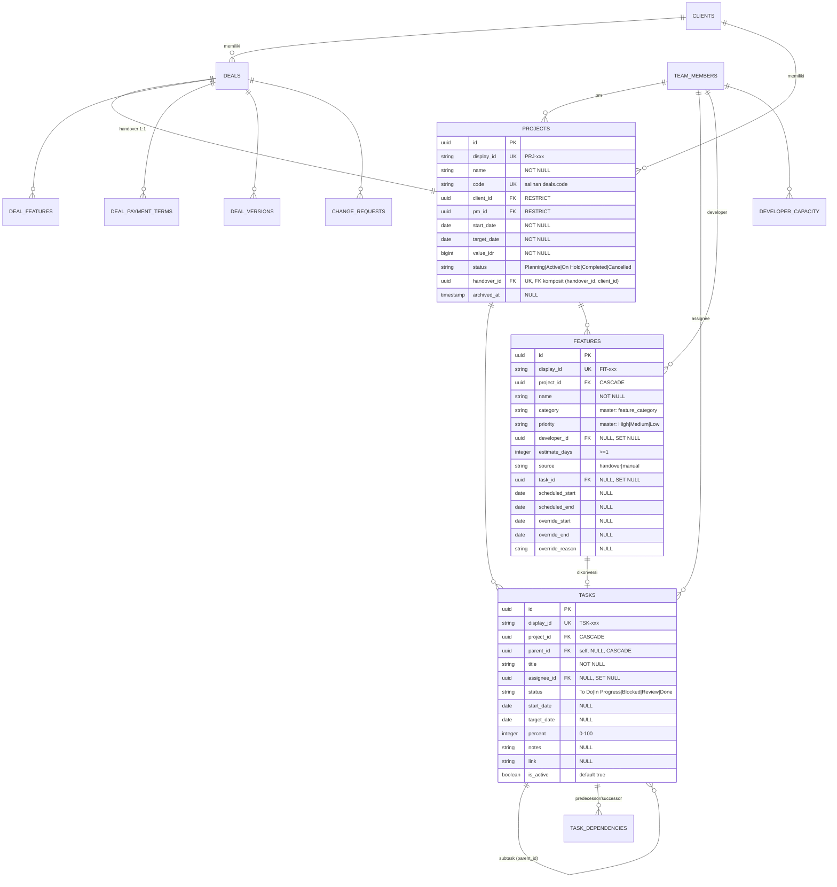

# DATABASE_PROYEK.md — Skema Tetap Database Proyek (Kontrak Lintas Aplikasi)

> **Status:** ANALISIS — kontrak integrasi untuk domain **Proyek** (US-019…US-026).
> **Sumber kebenaran:** `docs/DATABASE.md` (APPROVED 2026-10-05) + migrasi
> `frontend/supabase/migrations/*` + draf DDL `database/schema.sql`.
> **DBMS:** PostgreSQL 15 (Supabase) · **PK:** UUID v4 (`gen_random_uuid()`) ·
> **Timezone:** UTC (`timestamptz`; tanggal = `date`) · **Penamaan:** `snake_case`.
>
> Dokumen ini KEBALIKAN dari `DATABASE.md` yang mencakup seluruh modul: fokus
> ke **satu skema tetap** untuk tabel proyek agar aplikasi lain (website produksi
> yang menerima proyek setelah handover) dapat **membaca/menulis data yang sama**
> tanpa melanggar integritas referensial portal.

---

## 1. Mengapa dokumen ini ada

Alur saat ini: `Lead → Klien → Deal Handover → Proyek → … → serah terima ke website lain`.

Setelah handover **Dikonfirmasi**, proyek dibuat di portal (`projects`) lalu hasil
pekerjaan (task, fitur, jadwal) diteruskan ke aplikasi kedua (website portofolio /
produksi klien). Agar kedua sisi konsisten, dibutuhkan **kontrak skema yang tetap**:

1. **Identitas stabil** yang bisa dikaitkan lintas sistem (`display_id`, `code`).
2. **Batas tanggung jawab** — kolom mana dibaca (read-only dari portal), mana yang
   boleh ditulis balik (mis. progres/status oleh website).
3. **Enum & transisi** yang tidak boleh berubah sepihak (status proyek/task/termin).
4. **Aturan integritas** yang harus dipertahankan aplikasi kedua (format ID, 1:1 handover,
   klien sama, FK komposit).

---

## 2. Lingkup domain "Proyek"

### 2.1 Tabel inti proyek (milik domain ini)

| Tabel | Peran | US ref |
|-------|-------|--------|
| `projects` | Entitas proyek hasil handover | US-019, US-020, US-026 |
| `tasks` | Task berjadwal dalam proyek (pohon subtask) | US-022, US-024, US-025 |
| `task_templates` | Template task RAD/PUS/SAD | US-021 |
| `task_dependencies` | Relasi FS antar task (Gantt) | US-025 |
| `features` | Backlog fitur → task (penjadwalan) | US-023, US-024 |
| `developer_capacity` | Kapasitas developer (jam/hari) | US-024 |
| `holidays` | Kalender libur untuk penjadwalan | US-024 |

### 2.2 Tabel pendukung/handover (dibaca lintas batas)

| Tabel | Peran | US ref |
|-------|-------|--------|
| `deals` | Handover (aset `handover_id` proyek) | US-015…US-018 |
| `deal_features` | Scope fitur handover → impor `features` | US-015, US-023 |
| `deal_payment_terms` | Skema termin pembayaran | US-016 |
| `deal_versions` | Riwayat nilai/deadline (CR) | US-018 |
| `change_requests` | Perubahan lingkup (disetujui → sinkron proyek) | US-018 |
| `clients` | Klien pemilik proyek | US-014 |
| `team_members` | PM, developer, assignee | US-003, US-022… |
| `master_options` | Dropdown `feature_category`, `priority` | US-005 |

### 2.3 Tabel lintas-modul yang menunjuk proyek (polimorfik)

| Tabel | `entity_type` terkait |
|-------|----------------------|
| `comments` | `task`, `fitur`, `deal` |
| `attachments` | `task`, `fitur`, `deal` |
| `audit_logs` | `entity_type` = `tasks`, `features`, `projects`, `deals` |

> `comments`/`attachments` memakai `entity_id` UUID **tanpa FK** (polimorfik) —
> aplikasi kedua wajib menyimpan `display_id`-nya sendiri bila ingin menautkan balik.

---

## 3. Konvensi stabil (wajib dipertahankan lintas aplikasi)

| Aturan | Nilai | Catatan |
|--------|-------|---------|
| Primary key | `uuid` `gen_random_uuid()` | Jangan ganti ke integer/serial |
| Identitas publik | `display_id TEXT UNIQUE NOT NULL` | `PRJ-xxx`, `HDV-xxx`, `TSK-xxx`, `FIT-xxx`, `KLI-xxx`, `CR-xxx` |
| `display_id` | diisi trigger + sequence, padding **minimum** | Lebar 3 (PRJ/TSK/FIT/HDV/KLI/CR), tumbuh tanpa batas |
| Uang | `bigint` (IDR) | Bukan `numeric` |
| Tanggal | `date` untuk tenggat/awal; `timestamptz` untuk jejak | WIB = `(now() AT TIME ZONE 'Asia/Jakarta')::date` |
| Soft-archive | `archived_at` **hanya** `projects` (dan `leads`/`content_materials`) | Fokus proyek: `projects.archived_at` |
| Nama kolom/FK | FK `<tabel_tunggal>_id`; junction `<sing_a>_<sing_b>` | `project_id`, `handover_id`, `task_id` |
| Refresh | `created_at`/`updated_at` default `now()`; `updated_at` via trigger | - |

> **Kunci lintas aplikasi = `display_id` + `code`**, bukan UUID mentah. UUID internal
> boleh berubah antar-environment restore; `display_id` yang stabil menjadi jangkar
> relasi ketika website kedua menyimpan referensi proyek.

---

## 4. ERD domain proyek

---

## 5. Kamus data — tabel inti proyek

> `UK` = unique · `PK` = primary key · `FK` = foreign key.
> Kolom `(master)` divalidasi FK komposit ke `master_options(category, value)` via
> kolom generated `<kolom>_key TEXT GENERATED ALWAYS AS ('<kategori>') STORED`.

### 5.1 `projects`

| Kolom | Tipe | Null | Default | Constraint | Integrasi lintas aplikasi |
|-------|------|------|---------|------------|---------------------------|
| `id` | uuid | NO | gen | PK | Internal; jangan dipakai sebagai kunci bisnis |
| `display_id` | text | NO | trigger | UK, `PRJ-xxx` | **Kunci publik** utk website kedua |
| `name` | text | NO | - | - | Judul proyek (format FR-11) |
| `code` | text | NO | - | UK (disalin dari `deals.code`) | **Kode bisnis utama** lintas sistem |
| `client_id` | uuid | NO | - | FK → clients, RESTRICT | Klien pemilik |
| `pm_id` | uuid | NO | - | FK → team_members, RESTRICT | Project Manager |
| `start_date` | date | NO | - | - | Tanggal mulai |
| `target_date` | date | NO | - | - | Deadline; `CHECK start_date <= target_date` |
| `value_idr` | bigint | NO | - | CHECK > 0 | Nilai kontrak IDR |
| `status` | text | NO | 'Planning' | CHECK 5 status | Lihat §7 lifecycle |
| `handover_id` | uuid | NO | - | UK + FK komposit `(handover_id, client_id) → deals(id, client_id)`, RESTRICT | Jamin 1 handover = 1 proyek, klien sama |
| `archived_at` | timestamptz | YES | - | - | Soft archive (US-043) |
| `created_at` / `updated_at` | timestamptz | NO | now() | trigger `updated_at` | - |

### 5.2 `tasks`

| Kolom | Tipe | Null | Default | Constraint | Catatan |
|-------|------|------|---------|------------|---------|
| `id` | uuid | NO | gen | PK | - |
| `display_id` | text | NO | trigger | UK, `TSK-xxx` | Kunci publik task |
| `project_id` | uuid | NO | - | FK → projects, CASCADE | - |
| `parent_id` | uuid | YES | - | FK → tasks (self), CASCADE | Sub-task; hapus induk hapus anak |
| `title` | text | NO | - | CHECK panjang > 0 | - |
| `assignee_id` | uuid | YES | - | FK → team_members, SET NULL | (dahulu teks bebas) |
| `status` | text | NO | 'To Do' | CHECK 5 status | Lihat §7 |
| `start_date` / `target_date` | date | YES | - | CHECK mulai ≤ selesai | `NULL` = belum dijadwalkan |
| `percent` | integer | NO | 0 | CHECK 0–100 | Induk = rata-rata anak (service) |
| `notes` / `link` | text | YES | - | - | - |
| `is_active` | boolean | NO | true | - | Hard-logic nonaktif (bukan arsip) |
| `created_at` / `updated_at` | timestamptz | NO | now() | trigger | - |

### 5.3 `features`

| Kolom | Tipe | Null | Default | Constraint | Catatan |
|-------|------|------|---------|------------|---------|
| `id` | uuid | NO | gen | PK | - |
| `display_id` | text | NO | trigger | UK, `FIT-xxx` | - |
| `project_id` | uuid | NO | - | FK → projects, CASCADE | - |
| `name` | text | NO | - | CHECK panjang > 0 | - |
| `category` | text | NO | - | FK master (`feature_category`) | - |
| `priority` | text | NO | 'Medium' | FK master (`priority`: High/Medium/Low) | - |
| `developer_id` | uuid | YES | - | FK → team_members, SET NULL | - |
| `estimate_days` | integer | NO | - | CHECK ≥ 1 | Estimasi durasi |
| `source` | text | NO | - | CHECK `handover`/`manual` | Asal: impor handover atau manual |
| `task_id` | uuid | YES | - | FK → tasks, SET NULL, UNIQUE | Hasil konversi fitur→task |
| `scheduled_start` / `scheduled_end` | date | YES | - | - | Jadwal otomatis |
| `override_start` / `override_end` | date | YES | - | CHECK override wajib beralasan | Jadwal manual |
| `override_reason` | text | YES | - | CHECK diisi bila override | - |

### 5.4 `task_templates`

| Kolom | Tipe | Null | Default | Constraint |
|-------|------|------|---------|------------|
| `id` | uuid | NO | gen | PK |
| `name` | text | NO | - | UK (urutan RAD → PUS → SAD) |
| `ord` | integer | NO | - | CHECK ≥ 1 |
| `duration_days` | integer | NO | - | CHECK ≥ 1 |
| `is_active` | boolean | NO | true | - |

### 5.5 `task_dependencies`

| Kolom | Tipe | Null | Constraint |
|-------|------|------|------------|
| `predecessor_id` | uuid | NO | PK + FK → tasks, CASCADE |
| `successor_id` | uuid | NO | PK + FK → tasks, CASCADE |
| — | — | — | `CHECK predecessor_id != successor_id` (anti-siklus di service) |

### 5.6 `developer_capacity` & `holidays`

| Tabel | Kolom | Tipe | Null | Constraint |
|-------|-------|------|------|------------|
| `developer_capacity` | `developer_id` | uuid | NO | PK + FK → team_members, CASCADE |
| `developer_capacity` | `hours_per_day` | integer | NO | CHECK 1–24, default 8 |
| `holidays` | `day` | date | NO | PK |
| `holidays` | `name` | text | YES | - |

---

## 6. Kamus data — tabel handover & pendukung

### 6.1 `deals` (handover)

| Kolom | Tipe | Null | Constraint | Catatan |
|-------|------|------|------------|---------|
| `id` | uuid | NO | PK | - |
| `display_id` | text | NO | UK, `HDV-xxx` | Kunci publik handover |
| `title` | text | NO | CHECK > 0 | - |
| `code` | text | NO | UK | Disalin ke `projects.code` |
| `client_id` | uuid | NO | FK → clients, RESTRICT | - |
| `scope` / `objective` | text | NO | - | - |
| `value_idr` | bigint | NO | CHECK > 0 | Disalin ke `projects.value_idr` |
| `term_scheme` | text | NO | - | Ringkasan pembagian |
| `deadline` | date | NO | - | Disalin ke `projects.target_date` |
| `notes` | text | YES | - | - |
| `status` | text | NO | DEFAULT 'Draft', CHECK 4 status | `Draft`/`Menunggu Konfirmasi Produksi`/`Dikonfirmasi`/`Perlu Revisi` |
| `created_by` / `confirmed_by` | uuid | YES | FK → team_members, SET NULL | Sales / PM |
| `confirmed_at` | timestamptz | YES | - | - |
| — | — | — | `UNIQUE (id, client_id)` | Basis FK komposit `projects.handover_id` |

### 6.2 `deal_features`, `deal_payment_terms`, `deal_versions`, `change_requests`

| Tabel | Kolom kunci | Catatan |
|-------|-------------|---------|
| `deal_features` | `(deal_id, name)` PK; `description` NOT NULL | Scope impor ke `features(source='handover')` |
| `deal_payment_terms` | `deal_id`, `kind` (percent/amount), `value`, `due_date`/`milestone`, `status` (Belum Ditagih/Ditagih/Lunas) | `term_tempo` CHECK: wajib punya `due_date` atau `milestone` |
| `deal_versions` | `(deal_id, version)` PK; `value_idr`, `deadline`, `note` | Riwayat CR |
| `change_requests` | `display_id` `CR-xxx`; `kind`, `value_impact`, `deadline_impact`, `status` (Diajukan/Disetujui/Ditolak) | Disetujui → sinkron `projects.value_idr` + `target_date` |

### 6.3 `clients` dan `team_members` (referensi dibaca lintas batas)

| Tabel | Kolom relevan | Catatan |
|-------|---------------|---------|
| `clients` | `display_id` `KLI-xxx`, `company_name`, `phone`, `email`, `source_lead_id` | Pemilik proyek |
| `team_members` | `id`, `name` (UNIQUE), `status` (internal/external), `is_active`, `profile_id` | PM/developer/assignee; `name` = kunci tampilan |
| `master_options` | `(category, value)` PK, `is_active` | `feature_category`, `priority` |

---

## 7. Status lifecycle (kontrak enum — jangan diubah sepihak)

| Entitas | Nilai valid | Arah transisi |
|---------|-------------|---------------|
| `deals.status` | Draft → Menunggu Konfirmasi Produksi → Dikonfirmasi / Perlu Revisi | Dikunci service `deal-workflow` |
| `projects.status` | Planning / Active / On Hold / Completed / Cancelled | Dikelola PM; `CHECK` 5 nilai |
| `tasks.status` | To Do / In Progress / Blocked / Review / Done | Kanban; `CHECK` 5 nilai |
| `deal_payment_terms.status` | Belum Ditagih / Ditagih / Lunas | - |
| `change_requests.status` | Diajukan / Disetujui / Ditolak | - |
| `features.source` | handover / manual | - |
| `features.priority` | High / Medium / Low (master) | - |

> Aplikasi kedua **hanya boleh memakai nilai enum di atas**. Menambah/menghapus
> nilai = breaking change pada `CHECK` + service portal, wajib dikoordinasikan.

---

## 8. Kontrak integrasi lintas aplikasi

### 8.1 Identitas yang dipertukarkan

Saat handover proyek ke website kedua, payload minimal yang dibawa (jangkar relasi):

| Field | Sumber | Contoh |
|-------|--------|--------|
| `project_display_id` | `projects.display_id` | `PRJ-001` |
| `project_code` | `projects.code` (== `deals.code`) | `WEB-2026-014` |
| `client_name` | `clients.company_name` | `PT Sinar Jaya` |
| `client_display_id` | `clients.display_id` | `KLI-007` |
| `pm_name` | `team_members.name` via `projects.pm_id` | `Dinda Prameswari` |
| `handover_display_id` | `deals.display_id` | `HDV-012` |
| `start_date` / `target_date` | `projects.*` | `2026-11-01` / `2026-12-15` |
| `value_idr` | `projects.value_idr` | `25000000` |

### 8.2 Arah data

| Arah | Konten | Batasan |
|------|--------|---------|
| Portal → Website (read mostly) | `projects`, `tasks`, `features`, `deals` (scope), `clients`, `team_members` | Website membaca `display_id`/`code` sebagai kunci; kolom scope/tenggat bersifat informatif |
| Website → Portal (opsional, write-back) | progres task (`tasks.percent`, `tasks.status`), status proyek (`projects.status`) | Harus lewat API/RPC resmi; jangan menulis `handover_id`/`code`/`value_idr`/`status` deal |

### 8.3 Aturan yang wajib dijaga aplikasi kedua

1. **Jangan regenerate `display_id`** — pertahankan format `PRJ-xxx`/`TSK-xxx`/`FIT-xxx`/`HDV-xxx`.
2. **`code` unik lintas sistem** — jangan ada dua proyek dengan `code` sama dari dua sumber.
3. **1:1 handover** — satu `deals.display_id` hanya untuk satu `projects`.
4. **Klien sama** — klien proyek = klien handover (FK komposit).
5. **Uang = `bigint` IDR** — jangan menambah desimal/konversi mata uang di sisi skema.
6. **Tanggal `date`** — bandingkan WIB di lapisan aplikasi, bukan mengubah kolom ke `timestamp`.

---

## 9. Matriks relasi (domain proyek)

| Dari (FK) | Ke (PK) | Jenis | Wajib | ON DELETE | Alasan |
|-----------|---------|-------|-------|-----------|--------|
| `projects.client_id` | `clients.id` | N:1 | Ya | RESTRICT | Lindungi klien berproyek |
| `projects.pm_id` | `team_members.id` | N:1 | Ya | RESTRICT | Cegah hapus PM aktif |
| `projects.handover_id` + `client_id` | `deals.id` + `client_id` | 1:1 | Ya | RESTRICT | 1 handover = 1 proyek, klien sama |
| `tasks.project_id` | `projects.id` | N:1 | Ya | CASCADE | - |
| `tasks.parent_id` | `tasks.id` | self | Tidak | CASCADE | Hapus induk hapus anak |
| `tasks.assignee_id` | `team_members.id` | N:1 | Tidak | SET NULL | - |
| `task_dependencies.predecessor_id` | `tasks.id` | N:1 | Ya | CASCADE | - |
| `task_dependencies.successor_id` | `tasks.id` | N:1 | Ya | CASCADE | - |
| `features.project_id` | `projects.id` | N:1 | Ya | CASCADE | - |
| `features.developer_id` | `team_members.id` | N:1 | Tidak | SET NULL | - |
| `features.task_id` | `tasks.id` | 1:1 | Tidak | SET NULL | Tautan konversi |
| `developer_capacity.developer_id` | `team_members.id` | 1:1 | Ya | CASCADE | - |
| `deals.client_id` | `clients.id` | N:1 | Ya | RESTRICT | - |

---

## 10. Index penting (domain proyek)

| Tabel | Kolom | Alasan |
|-------|-------|--------|
| `projects` | `status` | Filter |
| `projects` | `pm_id` | Filter PM |
| `projects` | `client_id` | Filter klien |
| `projects` | `target_date` | Deadline watch |
| `tasks` | `project_id` | Board per proyek |
| `tasks` | `status` | Kanban + filter |
| `tasks` | `parent_id` | Sub-task |
| `tasks` | `assignee_id` | "Tugas saya" |
| `tasks` | `title` | GIN trigram (pencarian) |
| `features` | `project_id` | Backlog |
| `features` | `developer_id` | Filter developer |
| `task_dependencies` | `predecessor_id` / `successor_id` | Gantt + kaskade |
| `deals` | `status` / `client_id` / `created_by` / `confirmed_by` | Alur handover |
| `deal_payment_terms` | `deal_id` | - |
| `change_requests` | `deal_id` | - |

---

## 11. Catatan & risiko

- **RLS aktif deny-all** di semua tabel; akses lintas aplikasi memakai key/role
  terpisah (service account) — pastikan website kedua tidak memakai role end-user.
- **`archived_at`** hanya di `projects` untuk soft archive; data terarsip tetap bisa
  dibaca aplikasi kedua, tapi daftar aktif harus filter `archived_at IS NULL`.
- **`display_id` tumbuh tanpa batas atas** (padding minimum) — jangan asumsi lebar tetap.
- **`features` → `tasks`** konversi bersifat tautan (`features.task_id`) — aplikasi
  kedua yang menampilkan status fitur harus membaca `task_id` untuk sinkron progres.
- **CR Disetujui** memperbarui `projects.value_idr` + `target_date` (warisan FR-15) —
  aplikasi kedua harus menarik ulang kedua kolom setelah ada `change_requests` disetujui.

---

## 12. Perubahan skema = migrasi terkoordinasi

Sebelum mengubah tabel domain proyek (kolom, enum, FK), wajib:

1. Catat di `docs/DECISIONS.md` + `CHANGELOG.md`.
2. Tambah migrasi `frontend/supabase/migrations/<timestamp>_*.sql` (idempotent).
3. Sinkronkan draf `database/schema.sql` + dokumen ini.
4. Beri tahu tim aplikasi kedua (website produksi) tentang field baru/berubah,
   karena `display_id`, `code`, dan enum `status` adalah **kontrak lintas sistem**.